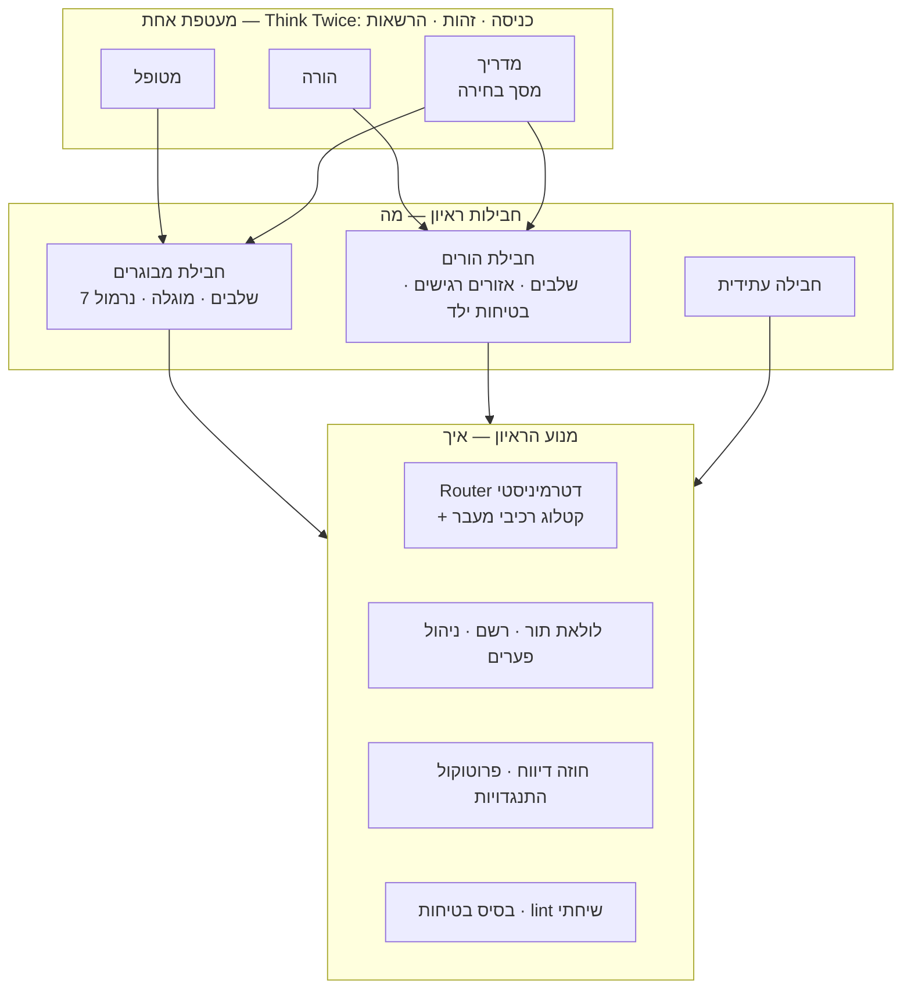

# תשתית ראיונות גנרית — תכנית רעיונית

**מעמד:** טיוטה v2 · 8.10.2026 (v1 · 3.10.2026) · שכבת התפיסה הרעיונית (לא אפיון יישום)
**מה השתנה ב-v2 (רן, 8.10.2026):** שלוש הכרעות. **עורך ראיונות** הוא יעד מוצהר, ולא אפשרות לעתיד (חלק 4א). **מעטפת אחת** עם כניסה דרך עמוד Think Twice, שם משתמש וראיונות לפי משתמש, במקום פריסה לכל מוצר (חלק 2א, וחלק 7 התהפך). **התחלנו:** פרוסה ראשונה של שלב 1 בוצעה (חלק 6).
**עדכון 10.10.2026:** שלב 1 הושלם בקוד (חלק 6). **ניהול משתמשים** הוגדר: חשבון לכל משתמש עם אימייל וסיסמה, הרשאה לכל מודל, תנאי שימוש, מיילים ומכסת ראיונות (חלק 2ב). שלב 4 במפת הדרכים נכתב מחדש לפיו.
**קהל:** רן. חלק 5 (ראיון ההורים) מיועד גם לנטלי או לבעלת התוכן הקלינית של הראיון החדש.
**מה זה:** תכנית להפוך את התשתית של Think Twice לתשתית שבונה ראיונות חצי-מובנים ייעודיים, וזה מעל כל נושא. הראיון הראשון שייבנה עליה: עיבוד אירוע של ילד עם ADHD שהתפרץ או הגיב באימפולסיביות, מנקודת המבט של ההורה.

---

## 0. תקציר

1. **הארכיטקטורה של Think Twice כבר נכונה, אבל התצורה שלה מרותכת לקוד.** ה-Router הדטרמיניסטי, ה-scorecard הנסתר, הרשם ושכבת הבטיחות הם מנוע ראיון. אבל שבעת השלבים, ה-slots, התלויות והחריגים הקליניים כתובים כקבועים בתוך `router.js`, `state.js`, `session.js` ו-`promptBuilder.js`. זו לא כתיבה מחדש. זו **חילוץ**.
2. **שלוש שכבות:** **מנוע** (ה"איך", כלומר אומנות הראיון, משותף לכולם) · **חבילת ראיון** (ה"מה", כלומר המודל המקצועי של ראיון אחד, תוכן דקלרטיבי) · **מעטפת** (ה"למי": כניסה, זהות, הרשאות לראיונות, מותג. אחת לכולם, ראו 2א).
3. **אגנוסטי לנושא, לא אגנוסטי לצורה.** הפלטפורמה יודעת לנהל סוג אחד של ראיון: חצי-מובנה, בשלבים, עם scorecard נסתר, ניתוב דטרמיניסטי ותוצר שנשאר בבעלות המשתמש. בתוך הצורה הזו, כל נושא.
4. **חבילה מרכיבה, היא לא מתכנתת.** חבילה בוחרת רכיבי מעבר מקטלוג סגור ומוכח (שער כיסוי, שער מפת-שחקנים, תלות, לוח הכרעה וכו') וקובעת להם פרמטרים. היא לא מזריקה לוגיקה. רכיב חדש הוא שינוי מנוע, ועובר את כל השערים של כל החבילות.
5. **החבילה השנייה היא המבחן של הפלטפורמה.** ראיון ההורים נכתב כחבילה בלבד. כל מקום שבו הוא מחייב לגעת במנוע הוא ממצא: מתעדים אותו, מכלילים, ומוודאים שהמבוגרים לא זזו.
6. **הקליניקה קודמת לקוד.** אף שורה של חבילת ההורים לא נכתבת לפני שקנבס הראיון (חלק 4) מולא ואושר קלינית.
7. **חבילה היא נתונים, כדי שאפשר יהיה לערוך אותה.** העורך (4א) הוא ממשק מעל חבילה. לכן חבילה היא JSON טהור מהיום הראשון, ו-`validatePack` הוא גם שער ההרצה וגם שער השמירה של העורך.
8. **מעטפת אחת, כניסה אחת.** כל המשתמשים נכנסים דרך עמוד Think Twice, מזוהים בשם משתמש, ומקבלים רק את הראיונות שהוגדרו להם (2א).

---

## 1. נקודת המוצא — מה כבר גנרי ומה תפור ל-Think Twice

### 1.1 ההבחנה כבר קיימת, במסמך המציג

המסמך המציג (חלק א) מגדיר את המוצר כשילוב של שתי יכולות:
- **המודל המקצועי** — ה"מה": הידע הקליני, סדר השלבים, העקרונות הטיפוליים.
- **ניהול השיח** — ה"איך": לדלות פרטים, להחזיק את החוט, לכוונן שאלות פתוחות וסגורות, להתגבר על התנגדויות, לשמור על מתח בריא.

**היכולת השנייה היא אגנוסטית לנושא מטבעה, והיא רוב מה שבנינו.** גם המתודולוגיה ב-transition-protocol §1 (הראיון החצי-מובנה, מודל צד"כ של "שיחה חופשית מקדימה ו-scorecard נסתר מאחור", עקרון המיצוי, טקסונומיית DICE, קשת פתח-השאלה) לא מדברת על ADHD בכלל. היא כבר המפרט של המנוע. התכנית הזו בסך הכול מפרידה בקוד את מה שהמסמך המציג מפריד במילים.

### 1.2 איפה Think Twice מרותך לקוד

| רכיב | מה בו כבר גנרי | איפה Think Twice תפור פנימה |
|---|---|---|
| **Router** (`src/core/router.js`) | מכונת מצבים דטרמיניסטית, סולם 0/1/2/U, סף רך 80%, מיצוי, אישור סיכום, Re-open, מגן עומס | `CORE_SLOTS` לשבעה שלבים · תלויות 5←2 ו-7←6 · שער מפת-שחקנים "בשלב 1" · לוח הכרעה "בשלב 7" · מגן עומס מיוחד לשלב 5 |
| **StateDocument** (`src/core/state.js`) | מאגרי דלתא לפי `id`, ‏`gaps`, ‏`nodes`/`edges`/`groups`, ייצוא/ייבוא | צורת `coverage` קבועה · `basket`/`board`/`decision` · ‏`kpi.emotionIntensityStage3/5` · ‏regex ‏`stage([1-7])` |
| **לולאת התור** (`src/core/session.js`) | בטיחות ← רשם ← מראיין ← פענוח ← Router ← סיכום/פתיח | `stage === 1` למפת השחקנים · ‏basket של שלב 6 · ‏decision של שלב 7 · ייבוא ישיר של `adapters/model.js` |
| **בונה הפרומפטים** (`src/core/promptBuilder.js`) | פיצול stable/volatile לקאשינג, סיכום state, עיגון פתיחים | 14 ייבואי `.md?raw` קבועים · מפת `STAGE_PROMPTS` של שבעה שלבים |
| **פרומפטים** (`src/content/prompts/`) | חוזה ה-JSON, כלל שאלה-אחת, פרוטוקול התנגדויות, מכניקת סיכום ופתיח | `persona.md` (עד 9.10.2026; היום `guidelines/think-twice-adult.md`) ("מבוגרים עם הפרעת קשב") · ‏`evaluator.md` (כ-46KB) מערבב את חוזה הדיווח עם הגדרות ה-slots |
| **אוצר מילים** (`src/core/vocabulary.js`) | יישויות, קשתות, צירים (מודל המאורע) | `NEVER_SHOW_SLOTS = wound, adhd_pattern` · ‏`MENTAL_SLOTS` לפי שלבים |
| **המפה** (`story.js`, `storyMap.js`) | הטלה, טופולוגיה, שער `confirmed` | `LAYERS` ממפה slots ספציפיים לשכבות |
| **UI** (`src/ui/`) | צ'אט, אישורים, מצב מדריך | תוויות `StageRail` · ‏`signposting.js` · לוח ההכרעה |
| **בטיחות** (`src/safety/index.js`) | בדיקת קדם ועצירה בטוחה | תבניות מצוקה של מבוגר על עצמו בלבד |
| **בדיקות** (`tests/transitions/router.test.js`) | מבנה המטריצה | נכתבו ידנית לשבעת השלבים |

**הממצא:** אין כאן ארכיטקטורה שצריך להחליף. יש תצורה שצריך לחלץ. וזה בדיוק החוב שכבר רשום ב-CLAUDE.md, עיקרון 4 ("ליבה ניידת — כרגע מופר, ביודעין: להזריק פרומפטים ואדפטר במקום לייבא אותם"). הפלטפורמה היא הסיבה לפרוע אותו עכשיו.

> **עדכון 10.10.2026:** שלב 1 הושלם בקוד. כל מה שבעמודה "איפה Think Twice תפור פנימה" עבר לחבילה, חוץ מהטקסטים בעברית של אומנות המנוע ומתבניות הבטיחות (ראו חלק 6, פרוסה 3). הטבלה נשארת כתמונת המצב שממנה יצאנו.

---

## 2. החזון — שלוש שכבות



| שכבה | המקבילה האנושית | מה היא מחזיקה | מי עורך אותה |
|---|---|---|---|
| **מנוע הראיון** | המראיין המיומן: האומנות שלו, ולא הנושא שעליו הוא מראיין | ניתוב, מיצוי, אישורים, Re-open, רשם, פערים, התנגדויות, lint, בסיס בטיחות, אדפטר מודל | רן + Claude, בשמירה של `router-guard` |
| **חבילת ראיון** | מדריך הראיון וגיליון הדירוג הנסתר (צד"כ) | שלבים, slots, מבחני מדידה, תנאי מעבר, אזורים רגישים, דמות, פרומפטי שלב, בטיחות נוספת, KPI, תסריטי זהב | הבעלים הקליני (נטלי) ← `prompt-editor` |
| **מעטפת** | המרפאה: שלט, כניסה, קבלה | כניסה ושם משתמש, מרשם משתמשים והרשאות, ניתוב לחבילה, מסך בחירה, טקסט פתיחה, מגדר פנייה, תדריך בודקים | רן |

**כלל הכיוון:** מעטפת מכירה חבילה, חבילה מכירה מנוע, מנוע לא מכיר אף אחת מהן. ב-`engine/` לא יופיעו "מוגלה", "ADHD", "בשר" ולא "שלב 7". בדיקה אוטומטית אוכפת את זה (חלק 6, שלב 2).

---

## 2א. מעטפת אחת — כניסה, זהות והרשאות (הכרעת רן, 8.10.2026)

**ההכרעה:** הכניסה תמיד דרך עמוד הכניסה של Think Twice (`think-twice-nine.vercel.app`). לכניסה נוסף שם משתמש, ולכל משתמש מוגדרים הראיונות שמותרים לו. הדוגמאות של רן (להמחשה בלבד):

| סוג משתמש | לאן הוא מגיע |
|---|---|
| הורה | ישר לראיון ההורים |
| מטופל | ישר לראיון על אירוע טעון (Think Twice למבוגרים) |
| מדריך | למסך בחירה, וממנו לכל אחד משני הראיונות |

**מה זה משנה בתכנית:** v1 המליצה על פריסה נפרדת לכל מוצר, ודחתה "פריסה אחת שמארחת את כל הראיונות" (חלק 7). ההכרעה הופכת את זה. משלושת החששות של v1, הזהות פותרת שניים: קהלים שונים כבר לא חולקים סיסמה אחת, ובודק לא רואה ראיון שלא הוגדר לו. החשש השלישי נשאר: **שחרור אחד משחרר את כל החבילות.** לכן `/ship-check` מריץ את השערים של **כל** החבילות בכל שחרור, ולא רק של זו שהשתנתה.

### הזרימה

כניסה (שם משתמש + סוד) ← השרת מאמת ← מחזיר את סוג המשתמש ואת החבילות שמותרות לו ← חבילה אחת: ישר לראיון · יותר מאחת: מסך בחירה ← הראיון רץ על החבילה שנבחרה, וה-state יודע איזו חבילה (וגרסה) הוא מריץ.

### ארבע אמיתות שצריך להחזיק

1. **שם משתמש בלי סוד משלו אינו זיהוי.** אם כולם חולקים סיסמה אחת, כל אחד יכול להקליד "מדריך" ולקבל הכול. לכן לכל משתמש (או לפחות לכל סוג) סוד משלו. ✅ **הוכרע (10.10.2026, 2ב):** לכל משתמש חשבון עם אימייל וסיסמה משלו.
2. **ההרשאה נאכפת בשרת, לא בהסתרה ב-UI.** ה-proxy כבר בודק את `APP_PASSWORD` בכל קריאה. הוא יבדוק משתמש וסוד באותה נקודה.
3. **מרשם המשתמשים הוא תצורה, לא תוכן משתמש,** ולכן עיקרון 6 מתיר אותו בצד השרת: משתנה סביבה ב-Vercel (למשל JSON של שם ← סוג ← גיבוב סוד), בלי מסד נתונים. תוכן הראיון ממשיך לא לצאת מהדפדפן. ⚠️ **השתנה (10.10.2026, 2ב):** משתמש שקובע סיסמה בעצמו, קודי אימות ומונה ראיונות משתנים בזמן ריצה, ומשתנה סביבה לא יכול להחזיק אותם. לכן נדרש מסד נתונים. **המלצה:** שמות משתמש פסבדונימיים ("הורה-03") ולא שמות אמיתיים. **החלטה לרן:** האם שם המשתמש נכנס לייצוא ולדוחות השגיאה (`api/report.js`). ברירת המחדל: לא.
4. **היום כל הפרומפטים נשלחים ב-bundle.** עם כמה חבילות ב-bundle אחד, הורה יכול לקרוא ב-DevTools את הפרומפטים של ראיון המבוגרים. הפרדה אמיתית = השרת מגיש רק את החבילה של המשתמש המאומת. זו בדיוק הטעינה בזמן ריצה שהעורך (4א) צריך ממילא. לפרוטוטייפ עם בודקים מוכרים זה אולי קביל. **החלטה לרן.**

### עיקרון 2 ומסך הבחירה

עיקרון 2 אוסר להאציל ניווט למשתמש **בתוך הראיון**. מסך הבחירה של המדריך נמצא **לפני** הראיון, במעטפת, ולא בו. ברגע שהראיון התחיל, הכלל חל במלואו. **שאלה קלינית:** האם משתמש פגיע (הורה, מטופל) יראה אי-פעם מסך בחירה? לפי הדוגמאות, לא: לכל אחד חבילה אחת. אבל הורה שמאובחן בעצמו (5.2 סעיף 2) הוא בדיוק המקרה שבו זה יעלה. אז שאלת המעטפת תהיה גם שאלה קלינית: איך נראית בחירה בלי שתהפוך לתפריט עבור מי שמגיע מוצף.

---

## 2ב. ניהול משתמשים (הגדרת רן, 10.10.2026)

### מה הוגדר

1. **הרשמה רק דרך מנהל המערכת.** בשלב הראשון אין הרשמה עצמית. המנהל מוסיף משתמש ידנית, במסך ניהול משתמשים.
2. **הרשאה לכל משתמש:** ‏Think Twice · אישי, ‏Think Twice · הורים, או שניהם.
3. **הזדהות באימייל וסיסמה.**
4. **מייל הצטרפות:** בהוספת משתמש נשלח מייל עם שם המשתמש וקישור לאפליקציה.
5. **כניסה ראשונה:** המשתמש מאשר את תנאי השימוש, קובע סיסמה, ומאמת את האימייל בקוד שנשלח אליו (תבנית מייל מוגדרת מראש).
6. **מייל "ברוך הבא!"** נשלח אחרי שהאימייל אומת (תבנית).
7. **שחזור סיסמה:** עמוד שחזור ותבנית מייל.
8. **שליחת השיחה במייל:** רק לכתובת שבחשבון, ובנוסף אפשר כתובת של מטפל, שהמשתמש מנהל בעצמו. לכל מודל ראיון תבנית משלו, ושם המודל מופיע בשורת הנושא ובגוף המייל.
9. **מסך בחירה בכניסה,** למשתמש שיש לו הרשאה ליותר ממודל אחד.
10. **מכסת ראיונות:** מספר ראיונות לתקופה (לחודש, לשנה וכן הלאה). ברירת המחדל לכולם: בלי הגבלה. רכיב במסך מציג את היתרה.

**מסמכים שצריך להכין:** תנאי שימוש (סעיף 5), ותבניות המייל: הצטרפות, קוד אימות, ברוך הבא, שחזור סיסמה, ושיחה לכל מודל.

### מה זה עושה לעקרונות 6 ו-8

- **נתוני החשבון נשמרים בשרת:** אימייל, גיבוב של הסיסמה (לא הסיסמה עצמה), הרשאות, מכסה, ומתי אושרו תנאי השימוש ובאיזו גרסה. זה לא תוכן ראיון, וההיגיון של 2א (אמת 3) חל עליו. אבל זו הפעם הראשונה שמידע אישי יושב בשרת של הפרויקט. **המלצה:** מותר, עם רשימה סגורה של שדות, וכל שדה חדש בהחלטה.
- **המכסה צריכה לדעת שראיון התחיל.** נרשמים רק פרטים טכניים: מי, איזה מודל ומתי. אף פעם לא תוכן.
- **סעיף 8 משנה את עיקרון 6 עצמו.** היום התוכן לא יוצא מהדפדפן בלי ייצוא ידני. שליחה במייל מעבירה את השיחה דרך השרת ושירות המייל, והיא נשמרת בתיבות הדואר. **צריך הכרעה מפורשת שלך.** הצורה המומלצת:
  - שליחה רק בלחיצה של המשתמש;
  - השרת שלנו לא שומר דבר;
  - נשלחת השיחה בלבד, בלי מידע פנימי (פערים, תוכן של אזורים חסומים);
  - נשלח רק לכתובות שבחשבון.

### הכרעות רן (10.10.2026): מינימום נתונים

1. **מלבד האימייל, המערכת לא מחזיקה שום נתון מזהה של המשתמש.** לא שם, לא שם משפחה, כלום. האימייל נשמר מוצפן.
2. **מידע על הפעילות באפליקציה לא נשמר בשום מקום.**
3. **תוכן הראיונות לא נשמר לא בשרת ולא בדפדפן, ובסיום הראיון הכול נמחק.** זה מבטל את עיקרון 8 (שחזור מקומי).

המחקר על רמת האבטחה הנדרשת נמצא ב-`docs/privacy-security-research.md`. **הממצא המרכזי:** גם רשימה של אימיילים בלבד היא כנראה מידע רגיש, כי הופעה ברשימה של האפליקציה הזו מגלה הפרעת קשב אצל האדם או אצל הילד שלו. ההמלצה היא לבנות לפי רמת האבטחה הבינונית בתקנות. בזכות מינימום הנתונים זה זול. המסקנות המשפטיות דורשות אימות של עורך דין.

**מה ההכרעה משנה בהגדרה של 2ב:**
- **מייל ההצטרפות בלי שם.** "שם המשתמש" הוא האימייל.
- **מגדר פנייה לא נשמר בחשבון.** הוא נבחר בתחילת כל ראיון, ונמחק בסופו.
- **אכיפה בשרת בלי לשמור ראיונות.** ראיון שנפתח מקבל אישור חתום וקצר-מועד, במקום רשומה במסד.
- **לוגים:** אף פעם לא אימייל או מזהה משתמש.
- **ארבע התנגשויות שצריכות הכרעה:**
  1. **כתובת המטפל (סעיף 8):** שמירה שלה סותרת "רק האימייל". (א) מקלידים אותה בכל שליחה, והיא לא נשמרת. (ב) שומרים אותה מוצפנת, כמו האימייל.
  2. **המכסה (סעיף 10)** היא מידע על פעילות. ההצעה המינימלית: משתמש בלי הגבלה, שהוא ברירת המחדל, לא נספר בכלל. משתמש עם הגבלה מקבל מונה אחד לתקופה הנוכחית: מספר בלבד, בלי זמנים ובלי מודל, והוא מתאפס בתחילת כל תקופה.
  3. **שליחת השיחה במייל (סעיף 8)** יוצרת עותק בתיבות הדואר ובלוגים של שירות המייל. זה סותר ישירות "לא נשמר בשום מקום".
  4. **הוכחת הסכמה לתנאי השימוש:** גרסה ותאריך אישור. זה נתון מינימלי, וכנראה נדרש משפטית. ההמלצה: לשמור.

**מה הבדיקה בקוד מצאה היום** (פירוט ב-`privacy-security-research.md` §5):
- ✅ **אחסון הדפדפן:** שום תוכן ראיון לא נשמר בו.
- ✅ **השרת שלנו:** לא שומר דבר.
- ❌ **בסיום הראיון הוא לא נמחק.** הוא נשאר בזיכרון הטאב ועל המסך עד "ראיון חדש", רענון או סגירה. אזהרת "לעזוב את האתר?" אף שומרת עליו מפני אובדן בטעות.
- ⚠️ **קובץ הייצוא:** כל אחד יכול להוריד את הראיון המלא, כולל מידע פנימי.
- ⚠️ **Anthropic:** התוכן עובר למודל. לפי התיעוד העדכני, הוא לא נשמר כברירת מחדל במודל שבשימוש, למעט אכיפה וחוק. צריך לאמת את זה בהגדרות הארגון.
- ⚠️ **חומרי פיתוח:** ממצאי ההרצות החיות מצטטים משפטים מהרצות בדיקה.

### הכרעות רן (10.10.2026, המשך): מסך הסיום, המייל והקובץ

1. **מסך סיום** מופיע בסוף הראיון, וגם כשהמשתמש מבקש לצאת באמצע. הוא אומר למשתמש בבירור:
   - שהמידע יימחק;
   - שהראיון יישלח אליו למייל;
   - ושאפשר להזין כתובת מייל נוספת, לבחירתו ולא חובה, שגם אליה הראיון יישלח.
2. **קובץ הראיון יורד תמיד.** בהמשך תיפתח האפשרות לטעון את הקובץ ולהמשיך מהנקודה שבה הראיון הסתיים. כך נשמר הרצף בין סשנים שונים על אותו מאורע. הרצף נשמר אצל המשתמש, לא אצלנו.
3. **Anthropic:** רן יבדוק את הגדרת השמירה בחשבון ויבקש "אפס שמירה".
4. **חומרי בדיקה:** כשיגיעו משתמשים אמיתיים, אף ראיון אמיתי לא נכנס לריפו או ל-Drive. אושר.

**מה זה סוגר מההתנגשויות למעלה:**
- **שליחה במייל (3) אושרה.** זה שינוי בעיקרון 6: השיחה עוברת דרך השרת ושירות המייל ונוחתת בתיבות. אצלנו לא נשמר דבר. השליחה לכתובת החשבון אוטומטית בסיום.
- **כתובת המטפל (1) נפתרה.** אין כתובת שמורה. כתובת נוספת מוקלדת במסך הסיום, משמשת לאותה שליחה בלבד, ונמחקת עם הראיון.

**מה זה פותח:**
- **הקובץ מחזיק מידע פנימי.** כדי שאפשר יהיה להמשיך ממנו, הקובץ צריך את כל ה-state, כולל `gaps` (הסתירות שנרשמו, מודיעין שאסור לשקף) והממצאים של האזורים החסומים. קובץ שיורד תמיד לכל משתמש מניח את כל זה על המחשב שלו, קריא לכל מי שפותח אותו. האפשרויות:
  - (א) **הקובץ בשני חלקים:** תמליל קריא למשתמש, ולצידו "חבילת המשך" מוצפנת שרק האפליקציה פותחת. **מומלץ.**
  - (ב) הקובץ בלי המידע הפנימי. ההמשך מתחיל בלי הסתירות שנרשמו.
  - (ג) הקובץ המלא, כמו היום.
- **המשך מקובץ אחרי עדכון גרסה.** היום ייבוא נטען רק מאותו מודל ובאותה גרסה (הכרעה מ-9.10.2026, כשמדובר היה בבודקים). כשהקובץ הוא הרצף של משתמש אמיתי, כל שחרור ינתק אותו מהמאורע שלו. כשיבנה ההמשך מקובץ, תידרש מדיניות התאמה בין גרסאות.
- **המייל נשלח לכתובת שבחשבון.** לכן הוא תלוי בחשבונות ובשירות המייל (שלב 4). עד אז מסך הסיום יכול להוריד קובץ ולמחוק, בלי מייל.

### מה חסר בהגדרה

**חובה לפני משתמש אמיתי:**
1. **מדיניות פרטיות,** בנוסף לתנאי השימוש. האפליקציה אוספת מידע רגיש, נפשי ומשפחתי, ולכן שני המסמכים צריכים בדיקה של עורך דין לפי חוק הגנת הפרטיות ותקנות אבטחת המידע.
2. **"זה לא טיפול ולא שירות חירום".** הצהרה בתנאי השימוש ובמסך, עם מספרים לפנייה במצוקה. זה מתחבר לשכבת הבטיחות.
3. **מידע על אנשים אחרים.** משתמשים מספרים על בני זוג, הורים וילדים. בראיון ההורים מדובר בקטינים. תנאי השימוש צריכים להתייחס לזה, וגם לגיל מינימלי למשתמש.
4. **חיי החשבון:** השבתה וחסימה, מחיקת חשבון והנתונים שלו לבקשת המשתמש, החלפת אימייל עם אימות מחדש, שליחת הזמנה מחדש, ותוקף להזמנה.
5. **אבטחה:**
   - אורך מינימלי לסיסמה;
   - נעילה זמנית אחרי כמה ניסיונות כושלים;
   - תוקף קצר לקוד האימות ולקישור השחזור, ושימוש אחד בכל אחד;
   - תוקף לחיבור, וכפתור התנתקות;
   - ניתוק כל החיבורים כשמחליפים סיסמה;
   - בשחזור, לא לגלות אם כתובת רשומה ("אם הכתובת קיימת, נשלח מייל");
   - יומן של פעולות המנהל;
   - אימות דו-שלבי לחשבון המנהל, שרואה את כל המשתמשים.
6. **המנהל הראשון:** איך הוא נוצר. ההצעה: `ranzak@gmail.com` מוגדר כמנהל בהגדרות השרת, לפי עיקרון הברזל.
7. **המעבר מהסיסמה המשותפת:** מה קורה לבודקים של היום, ומתי מכבים את `APP_PASSWORD`.

**חשוב, וצריך הגדרה:**
8. **מצב מדריך.** היום כל אחד יכול לפתוח אותו, והוא מציג את הניקוד, את הממצאים ואת המוגלה. עם חשבונות הוא צריך להיות הרשאה נפרדת, לבודקים ולקלינאים בלבד.
9. **"שם המשתמש" במייל ההצטרפות.** הכניסה היא באימייל. האם שם המשתמש הוא האימייל, או שם לפנייה ("שלום דנה")? בחשבון כדאי גם לשמור **מגדר פנייה**, וראיון ההורים צריך אותו ממילא (5.2 סעיף 7).
10. **כתובת המטפל:** טעות בכתובת שולחת מידע רגיש לאדם זר. ההמלצה: המטפל מקבל מייל אישור חד-פעמי, והמשתמש רואה את הכתובת לפני כל שליחה.
11. **המכסה:**
    - חודש קלנדרי או 30 יום מתגלגלים, ולפי שעון ישראל;
    - מה רואים כשהמכסה נגמרת;
    - האם המנהל יכול להוסיף או לאפס;
    - מה נחשב ראיון: ראיון שהתחיל, שהושלם, או כל לחיצה על "ראיון חדש".
12. **היסטוריית ראיונות.** עם חשבון, משתמשים יצפו לראות ראיונות קודמים. לפי עיקרון 6 אין כזו בשרת, וזה צריך להיכתב בתנאי השימוש.
13. **הרשאת "הורים" לפני שהמודל קיים.** ראיון ההורים עוד לא נבנה (שלב 3). מה רואה מי שיש לו הרשאה רק אליו?
14. **תמיכה:** כתובת לפניות, ומה רואה משתמש חסום.
15. **דוחות שגיאה:** האם מזהה המשתמש נכנס אליהם (2א, אמת 3; ברירת מחדל: לא).
16. **עלות:** המכסה מגינה גם על עלות המודל. כדאי לעקוב אחרי עלות לכל משתמש (בלי תוכן), ולהגדיר תקרת הוצאה כוללת.
17. **מיילים בעברית:**
    - מימין לשמאל;
    - שם שולח וכתובת לתשובה;
    - רשומות DNS בדומיין, כדי שהמיילים לא ייפלו לספאם.
18. **גרסאות של תנאי השימוש:** שומרים איזו גרסה אושרה ומתי, וגרסה חדשה מבקשת אישור מחדש.
19. **נגישות** של מסכי הכניסה והניהול.

### מה צריך ממך לפני שמתחילים לבנות

1. **סעיף 8:** האם לשנות את עיקרון 6 (ראו למעלה).
2. **מסד הנתונים:** ההמלצה היא Neon Postgres דרך Vercel, תחת `ranzak@gmail.com`.
3. **שירות המייל והדומיין:** ההמלצה היא Resend עם דומיין שבבעלותך. בלי דומיין, המיילים מגיעים רק אליך.
4. **מה נחשב ראיון למכסה:** ההמלצה היא ראיון שהתחיל, כלומר נשלחה תשובה ראשונה.
5. **מצב מדריך כהרשאה:** כן או לא. כולל: ייצוא קובץ רק במצב מדריך?
6. ✅ **שם המשתמש ומגדר הפנייה:** הוכרע בעקיפין (10.10.2026). אין שם. "שם המשתמש" הוא האימייל, ומגדר הפנייה נבחר בכל ראיון ולא נשמר.
7. **ההתנגשויות עם מינימום הנתונים** (למעלה): כתובת המטפל, מונה המכסה, שליחה במייל, ושמירת אישור התנאים.
8. ✅ **מסך הסיום, המייל והקובץ:** הוכרע (10.10.2026, למעלה).
9. **המידע הפנימי בקובץ שיורד תמיד:** (א) חבילת המשך מוצפנת, (ב) בלי מידע פנימי, או (ג) הכול. ההמלצה: (א).

---

## 3. חוזה הפלטפורמה — מה קבוע, מה נבחר, ומה מוגדר

### 3.1 אינווריאנטים: חבילה לא יכולה לשנות אותם

אלה עקרונות ההנדסה של CLAUDE.md, והם עולים מרמת "כללים של Think Twice" לרמת **חוזה הפלטפורמה**. כל חבילה יורשת אותם ואין לה מתג לכבות אותם:

1. **המודל מציע, הקוד מכריע.** אף חבילה לא נותנת ל-LLM להחליט על מעבר.
2. **אין ניווט למשתמש.** נקודות ההחלטה ב-UI הן רק אלה שהמנוע מגדיר (אישור סיכום, הכרעה סופית).
3. **פרומפטים הם תוכן**, ועכשיו גם **התצורה כולה היא תוכן.**
4. **ליבה ניידת.** המנוע רץ ב-Node נקי, וחבילה ואדפטר מוזרקים אליו.
5. **עברית-RTL אזרחית ראשונה**, כולל מגדר פנייה (ראו 5.2).
6. **אין אחסון בצד שרת.** ה-proxy נשאר חסר-state ומשותף לכל המוצרים.
7. **בטיחות: חבילה רק מוסיפה.** תבניות הבסיס של המנוע תמיד פעילות. חבילה יכולה להוסיף תבניות ופרוטוקולי עצירה, ואין לה דרך להסיר או להחליש אותם.
8. **Persistence מקומי** לפי התנאים של עיקרון 8, ו-`gaps` לעולם לא נשמר.

ובנוסף, מנגנונים שהם כבר מכניקה של המנוע:
- שאלה מכוונת אחת בכל תור, והרשימה השחורה הבסיסית (חבילה מוסיפה, לא מורידה). **חריג: האיסור על ז'רגון מקצועי אינו חלק מהבסיס.** זה כלל של מודל. אצל המבוגרים הוא אסור, ומול הורים ז'רגון מקצועי מותר ואף חשוב (הכרעת רן, 9.10.2026).
- סולם slot ‏0/1/2/U, ו-U הוא ערך סופי תקין.
- ~~סיכום ואישור לפני כל מעבר קדימה.~~ **תוקן (8.10.2026):** זה לא אינווריאנט. הכרעת רן מ-19.9.2026 (`next-version-changes.md` ‏A) מבטלת את ממשק "מדויק / לתקן" בסוף שלב, לטובת מעבר שהמראיין מנסח בתור אחד. שער האישור הוא רכיב בקטלוג (3.2), שחבילה בוחרת אם להשתמש בו. מה שנשאר אינווריאנט: **הקוד מחליט מתי עוברים, ולעולם לא המודל.**
- הרשם לא נותן ציונים ולא פונה למשתמש (אין לו ערוץ `message`).
- **מנגנון האזורים החסומים:** החבילה קובעת *אילו* slots לא יוצגו לעולם, והמנוע אוכף זאת *בכתיבה* לכל מאגרי התצוגה (כמו `setMapLabel` / `mergeNodes` היום).
- הפערים נסתרים מהמשתמש.

### 3.2 קטלוג רכיבי המעבר — ממנו חבילה בוחרת

**ההחלטה המרכזית בתכנית:** חבילה מתארת את תנאי המעבר שלה *כהרכב של רכיבים מוכחים מקטלוג סגור, עם פרמטרים*. היא לא כותבת לוגיקת ניתוב. כך נשמר עיקרון 1: הקוד שמכריע נבדק פעם אחת, ומשרת את כל החבילות.

כל רכיב בקטלוג קיים היום כקוד ספציפי לשלב מסוים, ועכשיו הופך לרכיב שאפשר לשבץ:

| רכיב | מה הוא עושה | איפה הוא חי היום | פרמטרים |
|---|---|---|---|
| **שער כיסוי** | כל ה-core ≥ 1, רובם 2, וגם מיצוי | כל שלב | סף רך (0.8), מונה מיצוי (2) |
| **כיסוי מלא** | כל ה-core ב-2 מעביר לבד | כל שלב | — |
| **שער בהירות יישויות** | חוסם מעבר כל עוד יישות מסוג X לא ברורה, והציון נגזר בקוד | מפת השחקנים, שלב 1 | סוג היישות, ה-slot שנגזר |
| **תלות** | שלב Y דורש ששלב X מוצה | 5←2, ‏7←6 | זוגות |
| **אישור סיכום + חסד תיקון** | סיכום ← "מדויק"/"לתקן" ← חלון תיקון | כל שלב | `REJECT_GRACE` |
| **מגן עומס** | backstop נגד תקיעה | 20 / 15 | לכל שלב (placeholder, ממתין לגלאי עייפות) |
| **אוסף** | צבירת אפשרויות לסל, בלי לדרג | שלב 6 | — |
| **הכרעה** | לוח מהסל, סיווג חדות, מבחן חבילה, "עמום לא סוגר" | שלב 7 | סוגי הכרעה תקפים |
| **חד-כיווניות + "או-או"** | אין חזרה מהכרעה לייצור, אלא אם יש מיזוג ממשי | 6→7 | זוג השלבים |
| **Re-open** | מידע סותר מוריד slot ופותח שלב עם פתיח מעוגן | כל שלב | — |
| **מדידת עוצמה** | עוגן ומדידה חוזרת, דלתא כ-KPI | רגש בשלב 3 מול 5 | שלב העוגן, שלב המדידה |
| **התנגדות ← פתח שאלה** | אות התנגדות קובע את הפתח | כל שלב | סדר עדיפויות |

**חבילה שצריכה רכיב שלא קיים:** זה לא חריג בתוך החבילה. זו בקשה לשינוי מנוע, שעוברת `router-guard` ואת מטריצות המעבר של *כל* החבילות.

### 3.3 מה חבילה מגדירה

| רכיב בחבילה | תוכן | המקבילה היום ב-Think Twice |
|---|---|---|
| **זהות ומטרה** | למי, באיזה מצב הוא מגיע, עם מה הוא יוצא | presenting-document, חלקים א–ב |
| **שלבים** | מזהה, מוקד, תווית למשתמש, signpost, פרומפט סוכן | `agents/stage*.md` · ‏`StageRail` · ‏`signposting.js` |
| **slots** | core slots לכל שלב, ומבחני מדידה (בפרומפט) | `CORE_SLOTS` · מבחן המצלמה |
| **תנאי מעבר** | הרכב מהקטלוג (3.2) ופרמטרים | קבועים ב-`router.js` |
| **אזורים רגישים** | slots חסומים לתצוגה, וכלל "מי מייצר" | הדגל `barred` על ה-slot (`wound` / `adhd_pattern`, מ-10.10.2026) · הטבלה ב-CLAUDE.md |
| **דמות המראיין** | זהות, קהל, קול | `guidelines/super.md` (משותף) + קובץ ייחודי למודל (מ-9.10.2026; עד אז `persona.md`) |
| **פרופיל התנגדויות** | דוגמאות ייעודיות מעל הפרוטוקול הגנרי | `resistance.md` (חלקו גנרי) |
| **רשימה שחורה** | תוספות ייעודיות | `forbidden.js` (חלקו ייעודי לשלבים 6–7) |
| **פרופיל בטיחות** | תבניות ופרוטוקול עצירה נוספים. **חובה** | `safety/index.js` (בסיס) |
| **מודל המקרה** | אוצר יישויות, קשתות וצירים, "שקלים" לשלבים | `vocabulary.js` · הדגל `mental` על ה-slot (עד 10.10.2026 `MENTAL_SLOTS`) |
| **שכבות המפה** | אילו slots מצוירים באיזו שכבה | `map.narrative` · ‏`map.timeline` (עד 10.10.2026 `LAYERS`) |
| **KPI** | מדדי הצלחה | ‏`kpi` ב-state · הרכיב `intensity` (דלתת הרגש) |
| **שערי איכות** | תסריטי זהב, פרסונות, ממדי שופט נוספים | `tests/fixtures` · ‏`judge.md` |
| **מקור אמת קליני** | תיקיית דרייב ובעלים קליני | תיקיית "Think Twice" |

**השדות סגורים (10.10.2026):** `validatePack` מקבל רק שדות שהמנוע קורא. שדה אחר הוא שגיאה, כי שגיאת כתיב בקובץ נתונים נכשלת בשקט: `bared: true` במקום `barred: true` היה משאיר את המוגלה על המסך. לכן כל שדה חדש בטבלה הזו, למשל פרופיל הבטיחות שראיון ההורים צריך (5.2 סעיף 6), נכנס כשינוי מנוע: מוסיפים אותו ל-`validatePack`, ממשים אותו במנוע, ורק אז החבילה יכולה להשתמש בו.

### 3.4 פיצול הפרומפטים: אומנות מול תוכן

היום כל פרומפט הוא תערובת. הפיצול:

- **פרומפטי מנוע (אומנות):** חוזה ה-JSON של הדיווח (סדר "חלץ, אז שאל", דלתות לפי `id`, nodes/edges/groups), כללי שאלה-אחת, מכניקת סיכום ופתיח, הליבה הגנרית של פרוטוקול ההתנגדויות, חוזה הרשם.
- **פרומפטי חבילה (תוכן):** דמות, סוכני שלב, הגדרות slots ומבחני מדידה, דוגמאות מהתחום, כללי אזורים רגישים, תוספות לרשימה השחורה.

**שתי מגבלות שהפיצול חייב לכבד:**
1. **סדר הקריאה הוא שאלה קלינית, לא טכנית** (ההערה ב-`buildSystemPromptParts`). המנוע מרכיב את החלקים *באותו סדר* שבו המודל קורא אותם היום.
2. **הקידומת היציבה נשמרת יציבה.** הקאשינג הוריד את עלות התור, ורק בגלל שהחצי שלא משתנה הוא קידומת. פרומפט מורכב מחלקים חייב להישאר `stable` + `volatile`.

הפיצול של `evaluator.md` ו-`registrar.md` נעשה **רק דרך `prompt-editor`**, ואחריו תסריטי הזהב והשופט, כמו כל שינוי פרומפט.

---

## 4. קנבס הראיון — איך מגדירים ראיון חדש

הקנבס הוא התבנית שהבעלים הקליני ממלא **לפני שנכתבת שורת קוד**. כל סעיף בו ממופה לרכיב בחבילה (3.3). הוא בנוי על אותן שאלות שהמסמך המציג וה-Transition Protocol ענו עליהן עבור המבוגרים:

| # | שאלה | ממופה ל- |
|---|---|---|
| 1 | **מי המרואיין?** מה המצב הרגשי שלו בכניסה, ומה הכי קל לפגוע בו? (המקבילה של ב.2) | דמות · ‏design brief · אזורים רגישים |
| 2 | **מתי הוא מגיע?** תרחישי כניסה (תוך כדי, אחרי, לקראת) | פרסונות · תסריטי זהב |
| 3 | **עם מה הוא יוצא?** התוצר שהוא לוקח מהראיון, וחוזה ההצלחה | השלב האחרון · רכיב הכרעה · KPI |
| 4 | **המודל המקצועי:** הקשת מהכניסה עד התוצר, כרצף שלבים | שלבים |
| 5 | **לכל שלב:** מוקד · core slots · מבחן מדידה לכל slot (המקבילה של "מבחן המצלמה") · תנאי מעבר · מה אסור בשלב | slots · תנאי מעבר · סוכן שלב |
| 6 | **תלויות:** מה חייב להיות ממוצה לפני מה | רכיב תלות |
| 7 | **אזורים רגישים:** מה המשתמש מייצר לבד, מה המראיין אומר כהשערה, ומה לעולם לא מוצג | slots חסומים · כללי "מי מייצר" |
| 8 | **דמות המראיין:** תכונות, קול, יחס לבקשת עצה | `guidelines`: קובץ העל המשותף + קובץ ייחודי למודל |
| 9 | **התנגדויות צפויות:** חמש פרסונות לפחות | פרופיל התנגדויות · פרסונות |
| 10 | **בטיחות:** מה עוצר את הראיון מיד, מה אומרים, לאן מפנים, האם קיימת חובת דיווח | פרופיל בטיחות |
| 11 | **איך נדע שזה עובד?** KPI, ארבעה תסריטי זהב, ממדי שופט | שערי איכות |

**התוצר של מילוי הקנבס הוא שני מסמכים:** מסמך מציג וטיוטת Transition Protocol לראיון החדש. רק מהם נגזרת החבילה. זה הסדר שבו Think Twice נבנה, והוא עבד.

**למה דווקא 11 (רן שאל, 8.10.2026):** אין במספר שום דבר מכונן. הוא יצא מספירה, לא מתכנון. עברתי על מה שהמסמך המציג וה-Transition Protocol של המבוגרים נאלצו להכריע, ואיחדתי לשאלה אחת כל מה שגורם קליני מכריע יחד. מתוך 14 רכיבי החבילה (3.3), שלושה לא נכנסו לקנבס כי הם לא שאלות קליניות אלא נגזרות הנדסיות: מודל המקרה, שכבות המפה ומקור האמת. שני כללים קבעו את הגרעיניות: (א) **שאלה = הכרעה שגורם קליני יכול לתת בלי להכיר את המנוע**; (ב) **שאלה = תוצר נפרד בחבילה**, כי שאלה שמערבבת שני תוצרים נענית בחצי. הסדר הוא הסדר שבו Think Twice נבנה בפועל: קהל ← תוצר ← קשת ← שלבים ← שמירה ← איכות. אם בפועל שתי שאלות ייענו תמיד יחד (5 ו-6, למשל, תלויות בתוך מוקד השלב), נאחד אותן. אם שאלה תתגלה כשתיים (10, בטיחות, אולי תתפצל לעצירה ולחובת דיווח), נפצל. כשהעורך (4א) יקום, הקנבס יהיה מסך הפתיחה שלו, ומספר השאלות ייקבע לפי מה שעבד בשתי החבילות הראשונות.

---

## 4א. עורך הראיונות (רן, 8.10.2026)

**הבקשה:** שהתשתית תאפשר לערוך את השלבים של כל ראיון ("המראיינים השונים") ואת ה-slots בתוך כל שלב. כלומר: editor של ראיונות חצי-מובנים.

**כן, לשם התכנית הולכת. עורך הוא ממשק מעל חבילה.** בלי חבילה שהיא נתונים, אין מה לערוך: היום שלב הוא קבוע ב-`router.js` ו-slot הוא שורה בפרומפט. שלב 1 של התכנית יוצר בדיוק את מה שהעורך עורך. מה שההכרעה משנה: v1 דחתה עורך ויזואלי ל"אחרי החבילה השלישית". עכשיו הוא יעד, וזה מטיל אילוצים **מהיום**:

1. **חבילה = נתונים טהורים (JSON).** בלי פונקציות ובלי לוגיקה. `validatePack` אוכף את זה, ובדיקה נכשלת אם החבילה של Think Twice מפסיקה להיות נתונים. ✅ בוצע.
2. **slot עובר מפרוזה לנתונים.** היום ה-slot הוא מזהה בתצורה, אבל *המשמעות* שלו (מה הוא, מבחן המדידה, דוגמאות) כתובה בפרוזה בתוך פרומפט הסוכן וב-`evaluator.md`. עורך שמוסיף slot בלי שההגדרה שלו מגיעה למודל יוצר slot שהמודל מעולם לא שמע עליו, וה-Router יחכה לו לנצח (רק מגן העומס יוציא אותו). לכן: לכל slot שדות של תווית, הגדרה, מבחן מדידה ודוגמאות, **והקטע בפרומפט שמונה את ה-slots נוצר מהנתונים.** זה השינוי הגדול ביותר, וזה שינוי פרומפט: `prompt-editor`, תסריטי זהב ושופט. שלב 2.
3. **`validatePack` הוא שער השמירה.** עריכה שמפרה את החוזה לא נשמרת, למשל הסרת slot שרכיב ההכרעה צריך, או תלות שמצביעה קדימה.
4. **מזהים יציבים, תוויות חופשיות.** היום מפתח השלב הוא `stageN` לפי מיקום, כי כך בנוי פורמט הייצוא. בעורך, הזזת שלב משנה מפתחות ושוברת ייצואים ישנים. שלב 2 מכריע על מזהי שלב יציבים ועל המרה של ייצואים ישנים.
5. **גרסאות.** כל שמירה = גרסת חבילה. כל ייצוא של ראיון רושם איזו חבילה ואיזו גרסה רצה. בלי זה אי אפשר לנתח הרצה חיה (`live-run-analyst`).
6. **מה העורך עורך ומה לא.** עורך: שלבים (הוספה, הסרה, סדר, שם), slots והגדרותיהם, טקסט סוכן השלב, בחירת רכיבים מהקטלוג והפרמטרים שלהם, תוויות, signposts, אזורים חסומים, דמות. לא עורך: את הלוגיקה של הרכיבים, את בסיס הבטיחות, את האינווריאנטים (3.1) ואת חוזה הדיווח. בקשה מעבר לזה = שינוי מנוע.
7. **עריכה בלי הרצה היא שינוי קליני בלי בדיקה.** העורך כולל הרצת ניסיון: הראיון בטיוטה רץ מול פרסונה מדומה (`sim/`) או מול העורך עצמו, עם מסלול ה-Router גלוי. פרסום עובר את תסריטי הזהב של החבילה.
8. **איפה עריכה נשמרת.** (א) **גיט:** העורך מפיק קובץ חבילה ← קומיט ← build. יש גרסאות, יש סקירה, הבדיקות רצות. הלולאה איטית (דקות). (ב) **אחסון בזמן ריצה:** עריכה חיה מיד. חבילה אינה תוכן משתמש, אז עיקרון 6 מתיר, אבל זו תשתית חדשה (KV/Blob). **המלצה:** (א) לפרסום, ובנוסף תצוגה מקדימה בדפדפן שמריצה טיוטה בלי לשמור אותה בשום מקום. כך לנטלי יש לולאה מהירה, והפרסום נשאר מבוקר.
9. **מי עורך.** הבעלים הקליני, בעברית ובמונחים שלו. היום רק `prompt-editor` עורך פרומפטים. העורך הוא הגרסה האנושית שלו, והכללים ש-`prompt-editor` אוכף הופכים לכללי `validatePack`.

---

## 5. המופע הראשון: ראיון הורים לילד עם ADHD

### 5.1 מה ידוע ומה חסר

**ידוע:** המרואיין הוא ההורה. האירוע: הילד התפרץ או הגיב באימפולסיביות. מטרת הראיון: לעבד את האירוע.
**חסר:** **מטרת הראיון.** המשפט "כשהמטרה היא:" בבקשה המקורית נקטע. כל השאר נגזר ממנה: השלב האחרון, התוצר, ה-KPI. השלד שבסעיף 5.3 כתוב כך שיעבוד עם כל אחת מההשערות שבסעיף 5.4, אבל לא מכריע ביניהן.

**הוכרע (רן, 9.10.2026) — המטרות של שני המודלים:**
- **מודל 1, עיבוד אירוע אישי טעון:** האדם שמתמודד עם ADHD פונה למערכת ומספר על מאורע שהוא רוצה לעבד, ולהבין איך להגיב לו. **מטרת הראיון:** לאפשר לו לבחור את צעדיו בצורה שקולה ויעילה.
- **מודל 2, ההורים:** עיבוד של מאורע שבו אדם עם ADHD התפרץ או התנהג בצורה שהקשתה על ההורה שלו. **מטרת הראיון:** לעבד את המאורע ולסייע להורה להתמודד בצורה אפקטיבית.

שתי הערות על הניסוח של מודל 2. האירוע רחב יותר מ"התפרצות": "התנהג בצורה שהקשתה" נכלל בו. וההכרעה לא מגבילה גיל, כלומר הילד יכול להיות בכל גיל, וזה רלוונטי לשאלה 7 ב-5.4.

### 5.2 מה שונה מהותית ממבוגרים, ולמה זה המבחן הנכון לפלטפורמה

ראיון ההורים קרוב מספיק כדי לרוץ על אותו מנוע, ושונה מספיק כדי לחשוף את כל המקומות שבהם המנוע עדיין מניח "מבוגר עם ADHD מעבד אירוע של עצמו":

1. **המרואיין אינו מי שהגיב באימפולסיביות.** במבוגרים זה אותו אדם. כאן יש שני גיבורים: הילד שהתפרץ וההורה שהגיב לו. במנוע זה נוגע במודל המקרה: עמודת שחקן לכל דמות (`eventView.js`) כבר קיימת, אבל ההנחה ש"self" הוא המרואיין צריכה להפוך לפרמטר.
2. **הנרמול מחליף בעלים.** `adhd_pattern` במבוגרים הוא נרמול של המרואיין עצמו. כאן מנרמלים כנראה את התנהגות *הילד* ("זה לא בכוונה, זו ויסות"). ייתכן שגם של ההורה: ADHD תורשתי במידה ניכרת, ולא מעט הורים לילדים עם ADHD מאובחנים בעצמם. זו שאלה קלינית, לא הנחה.
3. **מוגלה אחרת.** הדימוי העצמי הפגוע של הורה ("אני הורה גרוע", "נכשלתי", "כולם ראו") ובושה, במיוחד באירוע ציבורי או כשבית הספר מעורב. כלל "המשתמש מייצר את המוגלה, המראיין לעולם לא" עובר כמו שהוא, וזה בדיוק מה שמנגנון האזורים החסומים נועד לו.
4. **היציאה מעצמי היא כניסה לעולם של הילד.** שלב 5 של המבוגרים ("עמדת האחר") הופך כאן ל"מה עבר על הילד", וכנראה זה מהלב של הראיון ולא אחד מהשלבים.
5. **קאסט רחב יותר:** בן/בת זוג, אחים, צוות בית הספר, סבים, עוברים ושבים. מכלי `community` (בית, כיתה, משפחה מורחבת) הופכים מרכזיים.
6. **בטיחות היא סוג סיכון חדש.** במבוגרים: מצוקה של המרואיין עצמו. כאן מתווספים פגיעה של הילד בעצמו או באחרים, פגיעה בילד, הורה שחושש שיפגע ("כמעט הרבצתי לו"), וגילוי של התעללות. **ייתכנו חובות דיווח לפי דין.** זה חייב הכרעה קלינית ומשפטית לפני כל בודק. זו גם הסיבה שבחבילה פרופיל בטיחות הוא שדה חובה.
7. **מגדר בעברית.** אפליקציית המבוגרים פונה בלשון זכר. בקרב הורים חלק גדול מהמשתמשות הן אמהות, ולילד יש מגדר משלו (בן/בת). זו יכולת מנוע, לא קישוט: מגדר הפנייה ומגדר הדמויות הם פרמטרים של הסשן.
8. **אירועים חוזרים.** הורה עשוי לעבד אירוע דומה פעם בשבוע. הממד הלונגיטודינלי (gap-management §8) נעשה ממשי, אבל עיקרון 6 בתוקף: אין זיכרון בין סשנים מעבר לייצוא ידני. זה מחוץ לתכולה של הגרסה הראשונה.

### 5.3 שלד ראשוני — השערה לבדיקה, לא הכרעה

> ⚠️ **כל שורה בטבלה הזו היא השערה של מהנדס, שנגזרה באנלוגיה מראיון המבוגרים.** היא נקודת פתיחה לשיחה הקלינית בלבד, ובדיוק מה שהקנבס (חלק 4) נועד להחליף. אנלוגיה היא לא עיצוב קליני.

| # | תווית למשתמש | מוקד | core slots (השערה) | רכיבי מעבר |
|---|---|---|---|---|
| 1 | מה קרה | עובדות בלבד, מבחן המצלמה | טריגר · ציר זמן · שחקנים · זירה (בית/ציבור/בית ספר) · התנהגות הילד · תגובת ההורה ברגע · מצב עכשיו | כיסוי · שער בהירות שחקנים |
| 2 | איך הבנתי את זה | הפרשנות של ההורה להתנהגות | פרשנות סיבתית ("בכוונה", "מתגרה בי") · משמעות/תחזית ("ככה הוא יגדל") · **מוגלת ההורה** 🔒 | כיסוי |
| 3 | מה הרגשתי | הרגש של ההורה | רגש · עוצמה · הד מהעבר (כולל הילדות של ההורה עצמו) | כיסוי · מדידת עוצמה (עוגן) |
| 4 | איך הגבתי | התגובה בפועל והמתוכננת | תגובה אוטומטית · תגובה מתוכננת (עונש?) | כיסוי |
| 5 | מה עבר עליו/עליה | נקודת המבט של הילד | צורך הילד · הטריגר מבחינתו · **נרמול הדפוס** 🔒 · רגש מחודש של ההורה | כיסוי · תלות ב-2 · מדידת עוצמה (מדידה) |
| 6 | מה אפשר לעשות | סל אפשרויות | חלופות · פעולת-אפס · חלופה שנולדה מהשלב הקודם | כיסוי · אוסף |
| 7 | במה אני בוחר/ת | הכרעה | יעד · לוח · הכרעה חדה · מבחן חבילה | הכרעה · חד-כיווניות |

🔒 = אזור רגיש, חסום לתצוגה.

**מה השלד הזה מראה על הפלטפורמה, גם אם כל התוכן בו ישתנה:** הוא נבנה כולו מרכיבי הקטלוג הקיים. אם הקנבס יחזור עם שלב שלא ניתן להרכיב מהקטלוג (למשל "תכנית מניעה" עם מבנה משלה), זה הממצא הראשון של שלב 3 בתכנית.

### 5.4 שאלות קליניות פתוחות לחבילת ההורים

אלה לא מוכרעות כאן (CLAUDE.md: "ספק בשאלה קלינית ← לא להחליט לבד"). כשייקבע בעלים קליני לחבילה, הן ייכנסו לקובץ השאלות שלה דרך `clinical-triage`.

1. ✅ **מטרת הראיון הוכרעה (רן, 9.10.2026, ראו 5.1):** לעבד את המאורע ולסייע להורה להתמודד בצורה אפקטיבית. **נשאר להגדיר את התוצר:** עם מה ההורה יוצא בסוף? הכרעה על צעד, כמו במודל 1? תכנית לפעם הבאה? או הבנה ושקט? מזה נגזר השלב האחרון ומבחן החדות שלו. *(ההשערות הקודמות: (א) תגובה מושכלת עכשיו, כמו שיחת תיקון עם הילד או השלכה; (ב) הבנת הילד והורדת אשמה ובושה; (ג) תכנית מניעה לפעם הבאה; (ד) שילוב של הזמן הקרוב והרחוק. מה מהן, ומה מבחן החדות של כל אחת?)*
2. **של מי הנרמול?** של הילד, של ההורה, או של שניהם? ובאיזה שלב: בפרשנות (כמו במבוגרים) או בנקודת המבט של הילד?
3. **מוגלת ההורה:** האם היא slot חסום כמו במבוגרים? האם יש לה סוגים מוכרים (אשמה, בושה ציבורית, "ההורה שלא רציתי להיות")?
4. **בטיחות וחובת דיווח:** אילו אמירות עוצרות את הראיון? מה אומרים להורה? לאן מפנים? מה דין גילוי של פגיעה בילד בכלי שאינו מטפל ואינו שומר דבר?
5. **הד מהעבר:** האם לחקור את הילדות של ההורה עצמו? זה מנוף חזק, וגם כניסה לאזור רגיש.
6. **מי מגיע:** הורה אחד, או זוג הורים יחד? (המנוע הנוכחי מניח מרואיין אחד.)
7. **גיל הילד:** האם הראיון שונה לגיל הגן, לגיל בית הספר ולמתבגרים? אם כן, זו חבילה אחת עם פרמטר או כמה חבילות?
8. **פרסונות ההתנגדות של הורים:** השערה: המתגונן ("אני הורה טוב"), המוצף-באשמה, המאשים (את בית הספר, את בן/בת הזוג), המותש, "תגיד לי מה לעשות".
9. **ארבעת תסריטי הזהב:** אילו ארבעה אירועים מייצגים את הטווח? (בבית, בציבור, מול אחים, הודעה מבית הספר?)
10. **ז'רגון מקצועי מול ההורה:** רן הכריע ב-9.10.2026 שהוא מותר ואף חשוב. נשאר להגדיר אילו מונחים ובאיזה אופן: למשל "ויסות רגשי" ו"תפקודים ניהוליים", והאם להסביר כל מונח בקצרה בפעם הראשונה.
11. **בעלות קלינית:** האם נטלי היא הבעלים הקליני של חבילת ההורים, ומה מקור האמת שלה בדרייב?


### 5.5 אופי המראיין: משותף בהתחלה, ייפרד אחרי הבדיקות (הכרעת רן, 9.10.2026)

**ההכרעה:** בשלב הראשון ההנחות של המראיין זהות בשני הראיונות: הדמות, הטון, הטיפול בהתנגדויות, אופן העלאת סתירות ורשימת ה"אסור". רן צופה שזה ישתנה מיד כשיתחילו הבדיקות של ראיון ההורים. לדוגמה, מראיין של ילדים צריך להיות אמפתי יותר וזהיר יותר בהצבעה על סתירות, ומראיין של הורים יכול להיות ענייני ופחות טיפולי.

**מה כבר מוכן לזה:** רוב "אופי המראיין" הוא טקסט, ומאז 8.10 כל ראיון מקבל את הטקסטים שלו מבחוץ (`createEngine`). בשלב הראשון שתי החבילות יצביעו על אותם טקסטים. כשיגיע הבדל, כותבים גרסה לראיון אחד ומפנים אליה, בלי לגעת בקוד.

**שני דברים שצריך לדעת מראש:**
1. ✅ **בוצע 9.10.2026 (ראו חלק 11): הוא פוצל לקובץ על ולקובץ ייחודי.** **דף הדמות מערבב זהות עם הנחות עבודה.** השורה הראשונה של `persona.md` היא "מראיין של Think Twice — כלי טיפולי שמלווה מבוגרים עם הפרעת קשב". השורה הזו שונה בכל ראיון, וכל השאר (התכונות, הקול, כלל השאלה האחת) משותף. כשנבנה את ראיון ההורים, `prompt-editor` יפצל את הדף לחלק משותף ולחלק של זהות לכל ראיון. בדיקת טביעות האצבע תוודא שהפרומפט של המבוגרים לא זז באות.
2. **חלק מההתנהגות יושב בקוד, ומשותף היום לכל הראיונות.** הדוגמה "זהירות בהצבעה על סתירות" נוגעת בשני מקומות: הניסוח בטקסט, אבל גם **מתי** מידע סותר נרשם כפער. הספים של זה (`GAP_DEFAULTS`, ‏`src/core/state.js`) משותפים לכל ראיון, כי `session.js` לא מעביר ספים משלו. הפונקציה כבר מקבלת אותם כפרמטר, כך שזה צעד קצר. גם המיפוי מהתנגדות לסוג השאלה (`resolveResistance`, ‏`router.js`) ורף הציון של השופט (`meetsThreshold`, ‏`judge.js`, היום 4) משותפים. כשיגיע ההבדל הראשון שיושב בקוד, הוא יהפוך להגדרה בחבילה. זה שינוי מנוע, ולכן הוא עובר דרך `router-guard` (הכלל של 9.10).

**צירים שבהם צפוי פיצול** (רשימה לעקוב, לא לבנות מראש לפי כלל השניים, חלק 9):

| ציר | איפה הוא היום | מה יידרש כשיתפצל |
|---|---|---|
| אמפתיה וטון | טקסט (בלוקי `trait-*` בקובץ העל, סוכני השלבים) | בלוק באותו מפתח בקובץ הייחודי של המודל — גובר על העל |
| העלאת סתירות | טקסט + ספי הפערים בקוד | גרסת טקסט + ספים בחבילה |
| עומק טיפולי ("ענייני" מול "טיפולי") | טקסט + מבנה השלבים | גרסת טקסט, ואולי שלבים אחרים בחבילה |
| התנגדויות | טקסט (`resistance.md`) + מיפוי בקוד | גרסת טקסט, ואולי מיפוי בחבילה |
| ז'רגון מקצועי | טקסט: בלוק `voice` בקובץ העל ("אפס ז'רגון") + סעיף ברשימה השחורה (`forbidden.js`) + ממד "עברית טבעית" ברובריקת השופט | **הוכרע (רן, 9.10.2026): אסור במבוגרים, מותר וחשוב בהורים.** ההורים ידרסו את `voice` בקובץ הייחודי שלהם, יקבלו רשימה שחורה משלהם בלי הסעיף הזה, ורובריקת שופט משלהם. לכן `voice` **לא** ננעל |
| רף האיכות של השופט | רובריקה לכל חבילה (`judge.js`) + רף בקוד | רובריקה משלה, ואולי רף בחבילה |

---

## 6. מפת הדרכים

מסלול קליני ומסלול הנדסי רצים במקביל. ההנדסה לא נוגעת בחבילת ההורים לפני שהקנבס אושר. כל שלב מסתיים בבדיקות ירוקות ו-tag בגיט, כמו ב-dev-plan.

### מסלול קליני (במקביל לשלבים 1–2)

**שלב א — קנבס ההורים.** מילוי הקנבס (חלק 4) עם הבעלים הקליני, ומעליו המסמך המציג וטיוטת ה-Transition Protocol של ההורים. קודם מכריעים את השאלות שבסעיף 5.4, ואת שאלת הבטיחות לפני כולן.
**יציאה:** מסמכים מאושרים במקור האמת הקליני של החבילה.

### מסלול הנדסי

**שלב 1 — הפרדה בלי שינוי התנהגות.**
- הזרקה במקום ייבוא: פרומפטים ואדפטר מוזרקים למנוע (ובכך נפרע החוב של עיקרון 4, לפי התבנית של `judge.js` ו-`registrar.js`).
- כל קבוע של Think Twice עובר לאובייקט חבילה אחד: `CORE_SLOTS`, תלויות, שלבים מיוחדים, `NEVER_SHOW_SLOTS`, ‏`MENTAL_SLOTS`, ‏`LAYERS`, תוויות, signposts.
- Router, State ו-Session קוראים מהחבילה. מזהי השלבים של המבוגרים נשארים `stage1..stage7`, כך שייצואים ישנים ממשיכים להיטען.

**התקדמות (8.10.2026) — פרוסה 1 בוצעה:** ה-Router וה-State קוראים מהחבילה את השלבים, ה-slots, התלויות, שער מפת השחקנים, רכיבי האוסף וההכרעה, מגן העומס, הסף, המיצוי וחסד התיקון. גם תוויות פס השלבים וה-signposts עברו לחבילה. החבילה של Think Twice יושבת ב-`src/packs/think-twice-adult/pack.js`, והמנוע קורא חבילות ב-`src/core/pack.js` (כולל `validatePack`). חבילת ניסיון בת שלושה שלבים מוכיחה שה-Router מנתב לפי החבילה שהוא מקבל. טביעות האצבע של הפרומפטים לא זזו. **סקירת router-guard (8.10.2026):** בשום מצב תקין אין שינוי התנהגות. זה נבדק בהשוואה של 1.6 מיליון קריאות, קוד ישן מול חדש, בלי סטייה אחת. אבל היא מצאה ארבעה דברים, וכולם תוקנו:
- **(1) ההגנות נחלשו.** שישה ערכי ניתוב של Think Twice הפכו לעריכת שורה בחבילה שאף בדיקה לא תופסת. נוספו למטריצה בדיקות גבול עם מספרים קשיחים, וכל אחת מהעריכות נכשלת עכשיו.
- **(2) `validatePack` אישר חבילות שלולאת התור לא יודעת להריץ.** עכשיו הוא מפריד בין הפרת חוזה (`errors`) לבין מגבלות של המנוע הנוכחי (`limits`), לא זורק על קלט פגום, ובודק את חבילת ברירת המחדל כבר בטעינה.
- **(3) שלב לא מוכר נותב בשקט.** עכשיו הוא זורק, כמו לפני ההפרדה.
- **(4) תיעוד לא מעודכן.**

בנוסף היא מצאה **מבוי סתום ישן** (`U` בשלב 2 תוקע את שלב 4 לתמיד), שנרשם תחת `next-version-changes.md` ‏D.

**התקדמות (8.10.2026) — עיקרון 4 תוקן:** הליבה לא מייבאת עוד פרומפט, אדפטר או `import.meta`. `createEngine({ pack, prompts, complete })` (`src/core/engine.js`) מקבל מבחוץ את שלושת הדברים שהיו מרותכים פנימה:
- **החבילה:** המבנה.
- **הטקסטים:** 15 קבצי ה-`.md` ורשימת ה"אסור".
- **קריאת המודל.**

ייבואי `?raw` עברו לחבילה (`src/packs/think-twice-adult/prompts.js`). הדפדפן מרכיב את הראיון במקום אחד (`src/ui/interview.js`), והבדיקות באותה דרך (`tests/helpers/engine.js`). `tests/core/portable-core.test.js` סורק את הליבה ומריץ תור שלם ב-Node נקי, עם טקסטים וקריאת מודל מומצאים. זו גם ההוכחה שהמנוע לא קשור לטקסטים של Think Twice. טביעות האצבע לא זזו: הטקסט שהמודל מקבל זהה בייט לבייט. **סקירת router-guard: עבר** ושום עיקרון לא הופר. היו שישה ממצאים לא-חוסמים, וכולם תוקנו:
- בדיקת הניידות הייתה חלשה מכפי שטענה. היא נשענת עכשיו על hook שתופס כל ייבוא בגרף, ויש בדיקות ביקורת שמוכיחות שהוא תופס.
- בדיקת הבטיחות רצה לפני כל דבר אחר, כולל לפני דרישת התלויות.
- רשימת "אסור" ריקה וטקסט שלב חסר נכשלים בקול.
- טקסט הרשם נדרש רק כשהרשם דלוק.
- הבדיקות מריצות את אותו אובייקט שהדפדפן מריץ.
- רובריקת השופט כבר לא נשלחת לדפדפן.

**התקדמות (10.10.2026) — פרוסה 3 בוצעה, ושלב 1 הושלם בקוד (רן: "תבצע"):** לולאת התור, הרשם והמפה כבר לא מניחים שבעה שלבים. כל מה שהיה כתוב בקוד עבור Think Twice עבר לקובץ המבנה של הראיון:
- **הפניה ל-slot** (`stageN.slot`) נבדקת מול מספר השלבים של החבילה, ולא מול 1–7. זה החליף את אותו regex בתשעה מקומות בליבה.
- **מפת השחקנים** נבדקת ונגזרת בשלב וב-slot שהחבילה קובעת (הרכיב `castClarity`), ולא תמיד בשלב 1 וב-`actors`. כך גם ברשם.
- **הלוח והסגירה** נכתבים לשלב ההכרעה של החבילה, ולא ל-`stage7`. ניסוח החזרה לשלב החלופות לוקח את מספר השלב מהחבילה.
- **מדד עוצמת הרגש** נרשם בשלבים שנושאים את הרכיב החדש `intensity` (במבוגרים: 3 ו-5, כמו קודם).
- **ה-slots החסומים לתצוגה** (`barred`) **וה-slots של תודעה** (`mental`) הם דגלים על ה-slot בחבילה. עד היום הם היו רשימה קבועה בקוד (`wound`, `adhd_pattern`). כלומר, מוגלה של ראיון אחר בשם אחר הייתה מצוירת על המסך.
- **סדר המפה**, וה-slot שהופך אותה למסלול בזמן, הם `map` בחבילה.
- **מצב מדריך** מציג את השלבים של הראיון שרץ, בשמות שלו (`name` לכל שלב).

`validatePack` כבר לא מדווח על מגבלות מנוע. במקומן הוא בודק את מה שנוסף: קאסט אחד לכל ראיון, אותם דגלים לאותו שם slot בכל השלבים, ומפה שמצביעה רק על slots קיימים, ולעולם לא על slot חסום. `tests/core/pack-run.test.js` מריץ ראיון שלם, מהתור הראשון ועד הסגירה, על חבילה בת ארבעה שלבים עם slot חסום בשם אחר. הוא בודק שה-slot החסום לא מגיע לשום מאגר תצוגה, למפה, לסיכום, לפתיח או ללוח, ושהוא כן מגיע למראיין, שצריך אותו. בדקתי גם את הבדיקה עצמה: כשמסירים את החבילה מקריאה אחת בדרך, היא נכשלת. **אצל המבוגרים לא זז דבר:** טביעות האצבע של הפרומפטים זהות, מטריצת המעברים ירוקה, ו-932 בדיקות עוברות.

**סקירת router-guard (10.10.2026):** שום שינוי התנהגות אצל המבוגרים בדיווחים תקינים. היא מצאה שני פערים שהסרת המגבלות פתחה, ושלוש בעיות ישנות יותר. כולם טופלו:
- **רכיב בדיקת הקאסט בשלב ההכרעה** עבר את הבדיקה, אבל שם הוא לא בודק דבר, ו-slot של הכרעה שנגזר מהקאסט היה יכול לסגור את הראיון. עכשיו זו שגיאה, וגם רכיב שמופיע פעמיים באותו שלב.
- **שדה שהמנוע לא מכיר** עבר בשקט. השדות נסגרו (ראו 3.3).
- **ניסוח החזרה לשלב החלופות** של המבוגרים לא היה מוצמד בבדיקה. עכשיו הוא מוצמד מילה במילה.
- **slot שהמודל המציא** נכתב לציונים של השלב הנוכחי ואיפס את מונה המיצוי. ישן, ונראה יותר בחבילה עם פחות שלבים. עכשיו מתעלמים ממנו, כפי ש-test-plan כבר קבע.
- **הציון של הקאסט:** בכל תור שבו המודל לא דיווח מפת שחקנים, המספר שלו גבר על הגזירה מהמפה. עכשיו הקוד גוזר בכל תור שיש בו מפה, כפי ש-CLAUDE.md קובע. נשאר חריג אחד, והוא שאלה קלינית: מה הציון כשהמפה ריקה לגמרי, כלומר סיפור בלי אף אחד נוסף. הוא הועבר לנטלי (questions-for-natali §15).

**מה עוד יושב במנוע, ולא עבר במכוון:**
- **הטקסטים בעברית של אומנות המנוע:** הנחיית הסיכום, ההודעות לפתיח, הודעות הגיבוי וניסוח החזרה לשלב. הם לא מניחים שבעה שלבים, אבל הם טקסט בתוך קוד. הם יעברו בפיצול לאומנות ולתוכן (3.4), בשלב 2, דרך `prompt-editor`.
- **פנייה בלשון זכר** בהודעות הגיבוי. מגדר פנייה הוא יכולת מנוע שראיון ההורים צריך (5.2 סעיף 7).
- **תבניות הבטיחות** הן של מבוגר על עצמו. פרופיל בטיחות לכל חבילה (5.2 סעיף 6) הוא תנאי לראיון ההורים.

**נשאר כדי לסגור את שלב 1 רשמית:** `/ship-check` לפני השחרור הבא, ו-tag בגיט.

**יציאה (תנאי קשיח):** **הפרומפטים המורכבים זהים בייט-לבייט** לפני ואחרי (בדיקת snapshot לכל מצב: probe, רשם, סיכום, פתיח, לוח) · מטריצת המעברים המלאה ירוקה · תסריטי הזהב ירוקים · השופט ללא שינוי · `/ship-check` עובר. מבחינת הבודקים של המבוגרים, לא קרה כלום.

**שלב 2 — מנוע עם קטלוג.**
- קטלוג רכיבי המעבר (3.2). ה-Router מרכיב את תנאי המעבר מתוך הגדרת החבילה.
- סכמת חבילה ו**בודק חבילה** (pack-lint): לכל שלב יש slots ופרומפט · כל slot שמוזכר בפרומפט קיים · האזורים החסומים קיימים · אין מעגלי תלויות · יש פרופיל בטיחות · אין סוד עם קידומת `VITE_`.
- **בדיקות שנגזרות מהחבילה:** מטריצת מעברים שמיוצרת מתצורת החבילה, ומעליה בדיקות החוזה של המנוע (אינווריאנטים 3.1) שרצות על כל חבילה.
- **ולכל חבילה גם חוזה כתוב ביד (router-guard, 8.10.2026):** מטריצה שנגזרת מהנתונים הולכת אחרי הנתונים. אם מישהו מוחק תלות בחבילה, היא תיגזר מחדש בלעדיה ותעבור. לכן הכללים הקליניים של כל חבילה (ספים, תלויות, מגני עומס, רכיבים) נבדקים גם בבדיקות שהמספרים בהן כתובים ביד. ל-Think Twice זה כבר קיים (`tests/transitions/router.test.js`). שינוי של כלל כזה הוא תמיד מכוון: החבילה, הבדיקה והכרעה קלינית.
- **בדיקת טוהר המנוע:** `engine/` לא מכיל מונחי תחום. בדיקה שנכשלת על "מוגלה", "adhd", "stage7" וכו'.
- פיצול הפרומפטים לאומנות ולתוכן (3.4), דרך `prompt-editor`, ואחריו תסריטי זהב ושופט.
- **תנאים מוקדמים לעורך (4א):**
  - הגדרות slot כנתונים, וקטע ה-slots בפרומפט נוצר מהן.
  - מזהי שלב יציבים והמרת ייצואים ישנים.
  - ✅ (9.10.2026) המודל והגרסה נרשמים בראש כל ייצוא. ייבוא נטען רק מאותו מודל ובאותה גרסה, וקבצים ישנים לא נתמכים (חלק 11, פתוחה 0 שהוכרעה).

**יציאה:** חבילת המבוגרים רצה על המנוע הגנרי בלי שום קוד ייעודי · כל השערים ירוקים · הרצה חיה אחת מאשרת שההתנהגות והעלות לא זזו.

**שלב 3 — החבילה השנייה (ההורים).**
- כתיבת חבילת ההורים מהמסמכים של שלב א, ורק כחבילה.
- **כל צורך לגעת במנוע הוא ממצא:** מתעדים אותו, מכלילים במנוע, ומריצים מחדש את כל שערי המבוגרים. הצרכים הצפויים כבר עכשיו: "self" כפרמטר (5.2 סעיף 1), מגדר פנייה ודמויות (5.2 סעיף 7), פרופיל בטיחות מורחב (5.2 סעיף 6).
- ארבעה תסריטי זהב להורים · פרסונות התנגדות להורים · תסריטי בטיחות ב-100% · ממדי שופט נוספים אם הבעלים הקליני יגדיר.

**יציאה:** רף הקבלה של dev-plan שלב 6, מותאם לחבילה: 100% שאלה אחת · 0 תפריטים ו-0 המלצות · 4/4 תסריטי זהב מגיעים לסגירה · שופט ≥ 4/5 · בטיחות 100%.

**שלב 4 — מעטפת אחת: חשבונות, כניסה והרשאות (2א, 2ב).** *נכתב מחדש ב-10.10.2026 לפי הגדרת ניהול המשתמשים של רן.* השלב לא תלוי בשלבים 2–3, ואפשר להקדים אותו: חשבונות משרתים כבר את ראיון המבוגרים לבדו.

- **4.0 · החלטות, תשתית ומסמכים.**
  - ההחלטות של 2ב.
  - מסד נתונים, שירות מייל ודומיין, כולם תחת `ranzak@gmail.com` (עיקרון הברזל).
  - סוד לחתימת חיבורים, כמשתנה סביבה בלי קידומת `VITE_`.
  - טיוטות של תנאי השימוש ומדיניות הפרטיות, לבדיקת עורך דין.
  - תבניות המייל בעברית.
- **4.1 · חשבונות וחיבור.**
  - טבלאות: משתמשים, הרשאות, הזמנות, קודי אימות, קישורי שחזור, אישורי תנאים, ראיונות (פרטים טכניים בלבד), יומן מנהל.
  - הסיסמה נשמרת כגיבוב (scrypt), והחיבור הוא עוגייה מאובטחת.
  - המנהל הראשון מוגדר בהגדרות השרת.
- **4.2 · מסך ניהול משתמשים ומייל הצטרפות.**
  - הוספה, עריכת הרשאות ומכסה, שליחת הזמנה מחדש, השבתה ומחיקה.
  - כל פעולה נרשמת ביומן.
- **4.3 · כניסה ראשונה:** אישור תנאי השימוש ← קביעת סיסמה ← קוד אימות במייל ← מייל "ברוך הבא!".
- **4.4 · שחזור סיסמה:** עמוד, קישור חד-פעמי עם תוקף קצר, וניתוק החיבורים הקיימים.
- **4.5 · מסך בחירה ואכיפה בשרת.**
  - משתמש עם מודל אחד נכנס ישר לראיון. עם יותר ממודל אחד הוא רואה מסך בחירה, מחוץ לראיון (עיקרון 2).
  - ה-proxy בודק חיבור, הרשאה למודל, ושהראיון נפתח כחוק, במקום הסיסמה המשותפת. כך הוא גם מפסיק להיות גישה חופשית למודל לכל מי שמחזיק את הסיסמה.
- **4.6 · מכסה:** ספירה בשרת לפי התקופה, חסימה כשהיתרה נגמרת, ורכיב שמציג אותה.
- **4.7 · שליחת השיחה במייל, לחשבון ולמטפל.** רק אחרי ההכרעה על עיקרון 6.
  - תבנית לכל מודל.
  - השיחה בלבד, בלי מידע פנימי.
  - אישור חד-פעמי לכתובת המטפל.
- **4.8 · מעבר.**
  - הבודקים של היום מקבלים חשבונות, ו-`APP_PASSWORD` נכבה.
  - `/tester-brief` מותאם לחשבונות.
  - `/ship-check` מקבל שערי אבטחה: בלי חיבור, בלי הרשאה או בלי יתרה, ה-proxy מסרב.
- **בדיקות:**
  - תוקף ושימוש חד-פעמי לקודים ולקישורים;
  - נעילה אחרי ניסיונות כושלים;
  - אי-חשיפה של כתובות רשומות;
  - אכיפת הרשאה ומכסה בשרת;
  - תבניות המייל בשני המודלים;
  - שום תוכן ראיון לא נשמר בשרת ולא נרשם בלוג.
- **עיקרון הברזל חל גם כאן:** כל קומיט מ-`ranzak@gmail.com`.

**יציאה:** משתמש שהוזמן עובר כניסה ראשונה מלאה, ומגיע בדיוק למודלים שלו. ניסיון לגשת למודל לא מורשה, או לפתוח ראיון בלי יתרה, נחסם בשרת. מסמכי התנאים והפרטיות אושרו.

**שלב 5 — עורך הראיונות (4א).** *עודכן ב-8.10.2026: מיעד עתידי ליעד מוצהר.*
- **v1:** פתיחה מהקנבס · עריכת שלבים, slots והגדרותיהם, רכיבים ופרמטרים, תוויות וטקסט סוכנים · `validatePack` כשער שמירה · תצוגה מקדימה והרצת ניסיון בדפדפן, בלי לשמור · ייצוא קובץ חבילה לקומיט.
- **v2 (אם הלולאה דרך גיט תתגלה איטית מדי):** פרסום ישירות מהעורך לאחסון בזמן ריצה, עם גרסאות.
- `/new-interview` ודשבורד החבילה הופכים למסכים בעורך.
- **מה עדיין מחכה לשתי חבילות:** הצורה הסופית של העורך. הוא נבנה על שתי החבילות האמיתיות, כי מה שהן צריכות לערוך הוא מה שהעורך צריך לאפשר.

---

## 7. מבנה הריפו המוצע (ברמת המושג)

```
engine/                  ← src/core של היום + בסיס הבטיחות + ממשק האדפטר
  router · state · session · registrar · gaps · catalog/ (רכיבי מעבר)
  prompts/               ← פרומפטי האומנות: חוזה דיווח, רשם, סיכום, פתיח, התנגדויות-בסיס
packs/
  think-twice-adult/
    pack.config          ← שלבים, slots, רכיבים, אזורים חסומים, KPI, שכבות מפה
    prompts/             ← דמות, סוכני שלב, הגדרות slots, תוספות
    safety · forbidden · fixtures/ · docs/ (questions.md לחבילה)
  parents-adhd/
shell/                   ← src/ui של היום: רכיבים גנריים שקוראים חבילה + מותג
access/                  ← כניסה, מרשם המשתמשים (תצורה), ניתוב לחבילות
api/                     ← ה-proxy, ללא שינוי, משותף
tests/engine/ · tests/packs/<id>/
```

**ריפו נפרד או פרוטוקול שני באותו ריפו? (רן שאל, 8.10.2026) — פרוטוקול שני באותו ריפו.** ראיון ההורים יהיה חבילה שנייה תחת `src/packs/`, על אותה ליבה. ריפו נפרד היה מחייב אחד משניים: עותק של הליבה (fork, ראו למטה), או הפיכת הליבה לחבילת npm עם גרסאות. בשני המקרים כל תיקון בליבה עובר פעמיים, וזה בתקופה שבה הליבה עוד זזה כל יום. דוגמה טרייה: ה-deadlock של ‏D יצטרך תיקון אחד שחל על שני הראיונות. בנוסף, החבילה השנייה היא המבחן של ההפרדה: אם ראיון ההורים מחייב לגעת בליבה, זה נראה באותו commit, ליד הבדיקות של המבוגרים. וכניסה אחת (2א) פירושה פריסה אחת. **מתי לחזור לשאלה:** כשהליבה תתייצב ומישהו מחוץ לפרויקט ירצה לבנות עליה.

**ההחלטה, והחלופות שנדחו:** *(התהפכה ב-8.10.2026 בהכרעת רן, ראו 2א)*
- ✅ **ריפו אחד, מנוע אחד, מעטפת אחת, פריסה אחת** (`think-twice-nine.vercel.app`), וחבילות לפי משתמש. תיקון במנוע מגיע לכולם, והזהות היא שמפרידה בין קהלים.
- ❌ **Fork של הריפו לכל מוצר.** הכי מהיר בהתחלה, והכי יקר אחר כך: כל תיקון באג פעמיים, והענפים מתפצלים תוך שבועות. זה ההפך מתשתית.
- ⤺ **פריסה נפרדת לכל מוצר** (ההמלצה של v1). נדחתה כי הכניסה צריכה להיות אחת. מה שנשאר מהנימוק שלה: שחרור אחד משחרר את כל החבילות, ולכן השערים של כולן רצים בכל שחרור.

שם הריפו יכול להישאר `think-twice-app` בשלב זה. שינוי שם הוא קוסמטי ולא חוסם כלום.

---

## 8. מכונת העבודה `.claude/` — הופכת מודעת-חבילה

| היום | אחרי |
|---|---|
| `router-guard` | **שומר המנוע.** סוקר שינויי מנוע מול האינווריאנטים (3.1), ומריץ את מטריצות המעברים של **כל** החבילות |
| `prompt-editor` | עורך גם פרומפטי חבילה וגם פרומפטי מנוע. שינוי בפרומפט מנוע = תסריטי זהב ושופט של כל החבילות |
| `clinical-triage` | כותב לקובץ השאלות של החבילה הרלוונטית (`packs/<id>/docs/questions.md`) |
| `live-run-analyst` | מזהה מאיזו חבילה הגיע הייצוא, ובונה fixture בתיקייה שלה |
| `/ship-check` | מקבל חבילה ומריץ גם את בודק החבילה |
| — | **חדש:** `/new-interview` (שלב 5) |

ו-CLAUDE.md מתפצל: חלק מנוע (עקרונות ההנדסה, שהופכים לחוזה הפלטפורמה) וחלק לכל חבילה (הכללים הקליניים של שלב 2 של המבוגרים, תסריטי הזהב, הפרסונות).

---

## 9. סיכונים, ומה עושים איתם

| סיכון | למה זה מסוכן | המענה |
|---|---|---|
| **הכללת יתר** | בונים framework לראיונות מדומיינים, ומסבכים את המנוע בשביל צרכים שאף פעם לא יגיעו | **כלל השניים:** מכלילים רק מה ששתי חבילות אמיתיות צריכות בפועל. עורך ויזואלי רק אחרי השלישית |
| **עריכת שורה בחבילה משנה ניתוב קליני בשקט** | הכללים עברו מקוד שנסקר לקובץ נתונים. מחיקת תלות עוברת את כל הבדיקות שנגזרות מהנתונים | חוזה כתוב ביד לכל חבילה (שלב 2) · ‏`router-guard` סוקר כל שינוי בקובץ המבנה של ראיון (אושר 9.10.2026, חלק 11) |
| **רגרסיה אצל בודקי המבוגרים** | המוצר החי נשבר בזמן הריפקטור | שלב 1 מחייב פרומפטים זהים בייט-לבייט · חבילת המבוגרים היא חבילת הייחוס · tag לפני ואחרי |
| **פיצול הפרומפטים משנה התנהגות** | גם סדר שונה של אותו טקסט משנה את קריאת המודל | אותו סדר הרכבה · `prompt-editor` · שופט ותסריטי זהב · הרצה חיה |
| **אובדן הקאשינג** | פרומפט מורכב מחלקים מפסיק להיות קידומת יציבה, ועלות התור קופצת | חוזה `stable`/`volatile` נשמר במנוע · בדיקת `prompt-caching` לכל חבילה |
| **עיצוב קליני באנלוגיה** | ראיון ההורים נבנה כ"מבוגרים עם החלפת מילים" | מסלול קליני קודם · אין קוד לפני קנבס מאושר · 5.3 מסומן כהשערה |
| **בטיחות ילדים** | סוג סיכון שהמנוע מעולם לא טיפל בו, ואולי חובת דיווח | פרופיל בטיחות הוא שדה חובה · הכרעה קלינית ומשפטית לפני כל בודק · תסריטי בטיחות 100% |
| **שתי חבילות, תשומת לב אחת** | קשב הפיתוח מתפצל בזמן שהמבוגרים עוד בבדיקות | שלב 1 משרת גם את המבוגרים (פרעון חוב) · שלב 3 נפתח רק כשהקליניקה מוכנה |
| **מידע אישי ורגיש בשרת לראשונה** (2ב) | אימיילים, הרשאות ושימוש. דליפה פוגעת באנשים, ויש חובות לפי חוק הגנת הפרטיות | רשימה סגורה של שדות · אף פעם לא תוכן ראיון · בדיקת עורך דין · יומן מנהל · אימות דו-שלבי למנהל |
| **קוד הזדהות שנכתב אצלנו** (2ב) | טעות בקודים, בקישורים או בחיבורים פותחת חשבונות לזרים | ספריות מוכרות להצפנה (scrypt של Node) · תוקף ושימוש חד-פעמי · שערי אבטחה ב-`/ship-check` · סקירת אבטחה לפני משתמש אמיתי |
| **בלבול מקורות אמת** | שני דרייבים, שני בעלים קליניים, שני קבצי שאלות | הכלל של CLAUDE.md חל לכל חבילה בנפרד: הדרייב של החבילה = קליני, `/docs` של החבילה = טכני |

---

## 10. מה לא בתכנית

- **אין אחסון בצד שרת, אין חשבונות ואין זיכרון בין סשנים.** עיקרון 6 בתוקף לכל המוצרים.
- **אין עורך ויזואלי עכשיו** (ראו שלב 5).
- **אין ריבוי שפות.** עברית קודם. המנוע רק לא ינעל את האפשרות.
- **אין שינוי בתוכן הקליני של המבוגרים.** שלבים 1–2 הם ריפקטור טהור מבחינתם.
- **אין הכללה מעבר לצורה** (3 בתקציר). ראיון שאינו חצי-מובנה ובשלבים, כמו שאלון או צ'אט חופשי, הוא מוצר אחר.

---

## 11. החלטות שנדרשות מרן

**הוכרעו (8.10.2026):** תזמון — מתחילים עכשיו · מבנה — מעטפת אחת וכניסה דרך Think Twice (2א) · עורך — יעד מוצהר (4א) · ריפו אחד עם חבילה שנייה, לא ריפו נפרד (חלק 7).

**הוכרעו (9.10.2026, הכרעות רן):**
- **אין תמיכה בקבצי ייצוא ישנים** ("מדובר במספר זניח"). האפליקציה טוענת ייצוא רק מאותו מודל ראיון ובאותה גרסה.
- **שמות המודלים:** **Think Twice · אישי** (המזהה `think-twice-adult`) ו-**Think Twice · הורים** (המזהה `think-twice-parent`, כשייבנה). השם מופיע בראש כל ייצוא ובמסך הבחירה של המדריך.
- **גרסת האפליקציה עולה בכל שחרור לבודקים.** זה שלב 0 בפקודה `/deploy`: patch לתיקונים, minor לשינוי שבודק ירגיש, ו-tag בגיט לכל שחרור. ההרשאות שהשלב צריך (עדכון גרסה, ושמירה, תג ו-push לגיט) אושרו במפורש ע"י רן. כך מכל ייצוא אפשר לדעת מאיזה שחרור הוא הגיע, ומשם גם מאיזה commit.
- **ז'רגון מקצועי — לא ננעל, והוא כלל של מודל.** אצל המבוגרים הוא נשאר אסור. מול הורים הוא מותר ואף חשוב. בלוק הטון (`voice`) בקובץ העל לא יינעל, וקובץ ההורים ידרוס אותו (ראו 5.5).
- **הנחיות המראיין בשתי שכבות.** קובץ "על" (`src/content/prompts/guidelines/super.md`) חל על כל מראייני Think Twice, למשל "לצאת מדברי המרואיין". לכל מודל ראיון יש קובץ ייחודי עם הנחות עבודה משלו, **והייחודי גובר על העל**. ההכרעה מי גובר נעשית בקוד (`src/core/guidelines.js`): הבלוק של המודל מחליף את בלוק העל באותו מקום, והמודל לא רואה את ההנחיה שהוחלפה. **מה שזה לא מבטיח (router-guard, 9.10):** בלוק חדש שרק המודל מוסיף לא נבדק מול העל, ויכול לסתור אותו, גם הנחיה נעולה. נעילה מגינה על השם של הבלוק, לא על הכלל. לכן מה שמודל מוסיף נקרא ע"י `prompt-editor`, ובדיקת התור (lint) נשארת השומר האמיתי של "שאלה אחת". חריג אחד: בלוק נעול (`locked`). היום נעול רק "שאלה מכוונת אחת בכל תור", שהוא כלל קשיח ב-CLAUDE.md. הפיצול של `persona.md` לשני הקבצים לא שינה אף בייט אצל המבוגרים.
- **לכל מודל ראיון מזהה, שם וגרסה** (`id` · `name` · `version` בקובץ המבנה), **וקובץ הייצוא נפתח בהם ובגרסת האפליקציה.** גרסת האפליקציה היא מספר הגרסה מ-`package.json` ושם ה-bundle. אין בה חותמת זמן או hash של git, כדי לא לשבור את טביעת ה-bundle ש-`/ship-check` משווה. ייבוא נטען רק מאותו מודל ובאותה גרסה, וקבצי ייצוא ישנים לא נתמכים (הכרעת רן, 9.10.2026).

**הוכרעו (9.10.2026, רן קיבל את ההמלצה):**
- **שינוי בקובץ המבנה של ראיון** (`src/packs/*/pack.js`) **מחייב את `router-guard`** ואת מטריצת המעברים, כמו שינוי בקוד ה-Router. עודכנו `CLAUDE.md` ו-`.claude/agents/router-guard.md`.
- **רק `prompt-editor` משנה את מיפוי הטקסטים** (`src/packs/*/prompts.js`). מה שתופס מיפוי שגוי הוא בדיקת טביעות האצבע, לא תסריטי הזהב או השופט. ההצעה המקורית ("להריץ אחריו תסריטי זהב ושופט") נפסלה כי אף אחד מהשניים לא היה מגלה החלפה בין טקסטים. עודכנו `CLAUDE.md` ו-`.claude/agents/prompt-editor.md`.
- **נקודה שעלתה בדרך, פתוחה:** אין היום בדיקה אוטומטית שמריצה ראיון חי עם הטקסטים העדכניים. השופט מדרג תמליל קבוע, ותסריטי הזהב רצים מול מודל מדומה. רק הרצה חיה ידנית (`/live-test`) בודקת טקסט חדש מול המודל האמיתי.

**פתוחות:**
0. ✅ **מדיניות גרסאות — הוכרעה (רן, 9.10.2026): אין תמיכה בקבצי ייצוא ישנים, כי מדובר במספר זניח.** ייבוא נטען רק מאותו מודל ובאותה גרסה. כל קובץ אחר נחסם: מודל אחר, גרסה אחרת, או ייצוא מלפני שהקובץ התחיל לציין מודל וגרסה.
1. ✅ **מטרת ראיון ההורים — הוכרעה ב-9.10.2026 (5.1).** נשאר: התוצר בסוף הראיון (5.4 שאלה 1).
2. **בעלות קלינית:** מי הבעלים של חבילת ההורים, ומה מקור האמת שלה בדרייב?
3. ✅ **סוד לכל משתמש** — הוכרע (10.10.2026): לכל משתמש אימייל וסיסמה (2ב).
4. **פרומפטים ב-bundle** (פשוט, וכל משתמש יכול לקרוא את כולם) או **מוגשים מהשרת לפי משתמש** (2א, אמת 4).
5. **מזהה המשתמש בייצוא ובדוחות השגיאה:** כן או לא (ברירת מחדל: לא). עם חשבונות זה האימייל, ולכן חשוב עוד יותר.
6. **אחסון עריכות:** גיט בלבד, או גם אחסון בזמן ריצה (4א, סעיף 8).
7. **ניהול משתמשים (2ב, 10.10.2026)** — לפני שבונים:
   - שליחת השיחה במייל: האם לשנות את עיקרון 6;
   - מסד הנתונים;
   - שירות המייל והדומיין;
   - מה נחשב ראיון למכסה;
   - מצב מדריך כהרשאה;
   - ההתנגשויות שנשארו עם מינימום הנתונים: מונה המכסה ואישור התנאים (כתובת המטפל והשליחה במייל הוכרעו);
   - המידע הפנימי בקובץ שיורד תמיד.

   פירוט והמלצות ב-2ב.
