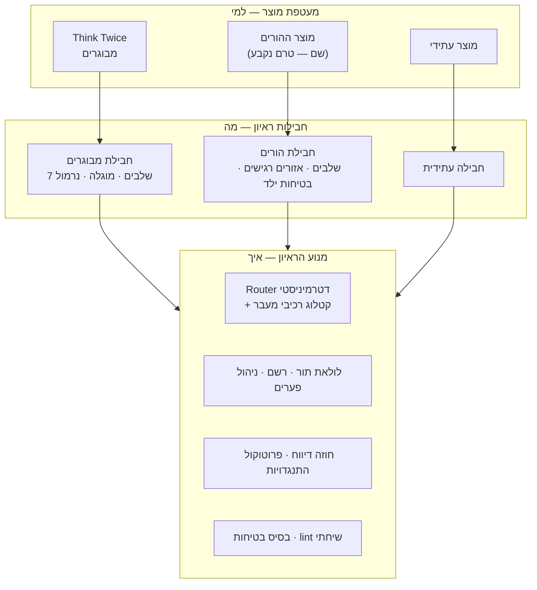

# תשתית ראיונות גנרית — תכנית רעיונית

**מעמד:** טיוטה v1 · 3.10.2026 · שכבת התפיסה הרעיונית (לא אפיון יישום)
**קהל:** רן. חלק 5 (ראיון ההורים) מיועד גם לנטלי או לבעלת התוכן הקלינית של הראיון החדש.
**מה זה:** תכנית להפוך את התשתית של Think Twice לתשתית שבונה ראיונות חצי-מובנים ייעודיים, וזה מעל כל נושא. הראיון הראשון שייבנה עליה: עיבוד אירוע של ילד עם ADHD שהתפרץ או הגיב באימפולסיביות, מנקודת המבט של ההורה.

---

## 0. תקציר

1. **הארכיטקטורה של Think Twice כבר נכונה, אבל התצורה שלה מרותכת לקוד.** ה-Router הדטרמיניסטי, ה-scorecard הנסתר, הרשם ושכבת הבטיחות הם מנוע ראיון. אבל שבעת השלבים, ה-slots, התלויות והחריגים הקליניים כתובים כקבועים בתוך `router.js`, `state.js`, `session.js` ו-`promptBuilder.js`. זו לא כתיבה מחדש. זו **חילוץ**.
2. **שלוש שכבות:** **מנוע** (ה"איך", כלומר אומנות הראיון, משותף לכולם) · **חבילת ראיון** (ה"מה", כלומר המודל המקצועי של ראיון אחד, תוכן דקלרטיבי) · **מעטפת מוצר** (ה"למי": מותג, קהל, פריסה).
3. **אגנוסטי לנושא, לא אגנוסטי לצורה.** הפלטפורמה יודעת לנהל סוג אחד של ראיון: חצי-מובנה, בשלבים, עם scorecard נסתר, ניתוב דטרמיניסטי ותוצר שנשאר בבעלות המשתמש. בתוך הצורה הזו, כל נושא.
4. **חבילה מרכיבה, היא לא מתכנתת.** חבילה בוחרת רכיבי מעבר מקטלוג סגור ומוכח (שער כיסוי, שער מפת-שחקנים, תלות, לוח הכרעה וכו') וקובעת להם פרמטרים. היא לא מזריקה לוגיקה. רכיב חדש הוא שינוי מנוע, ועובר את כל השערים של כל החבילות.
5. **החבילה השנייה היא המבחן של הפלטפורמה.** ראיון ההורים נכתב כחבילה בלבד. כל מקום שבו הוא מחייב לגעת במנוע הוא ממצא: מתעדים אותו, מכלילים, ומוודאים שהמבוגרים לא זזו.
6. **הקליניקה קודמת לקוד.** אף שורה של חבילת ההורים לא נכתבת לפני שקנבס הראיון (חלק 4) מולא ואושר קלינית.

---

## 1. נקודת המוצא — מה כבר גנרי ומה תפור ל-Think Twice

### 1.1 ההבחנה כבר קיימת, במסמך המציג

המסמך המציג (חלק א) מגדיר את המוצר כשילוב של שתי יכולות:
- **המודל המקצועי** — ה"מה": הידע הקליני, סדר השלבים, העקרונות הטיפוליים.
- **ניהול השיח** — ה"איך": לדלות פרטים, להחזיק את החוט, לכוונן שאלות פתוחות וסגורות, להתגבר על התנגדויות, לשמור על מתח בריא.

**היכולת השנייה היא אגנוסטית לנושא מטבעה, והיא רוב מה שבנינו.** גם המתודולוגיה ב-transition-protocol §1 (הראיון החצי-מובנה, מודל צד"כ של "שיחה חופשית מקדימה ו-scorecard נסתר מאחור", עקרון המיצוי, טקסונומיית DICE, קשת פתח-השאלה) לא מדברת על ADHD בכלל. היא כבר המפרט של המנוע. התכנית הזו בסך הכול מפרידה בקוד את מה שהמסמך המציג מפריד במילים.

### 1.2 איפה Think Twice מרותך לקוד

| רכיב | מה בו כבר גנרי | איפה Think Twice תפור פנימה |
|---|---|---|
| **Router** (`src/core/router.js`) | מכונת מצבים דטרמיניסטית, סולם 0/1/2/U, סף רך 80%, מיצוי, אישור סיכום, Re-open, מגן עומס | `CORE_SLOTS` לשבעה שלבים · תלויות 5←2 ו-7←6 · שער מפת-שחקנים "בשלב 1" · לוח הכרעה "בשלב 7" · מגן עומס מיוחד לשלב 5 |
| **StateDocument** (`src/core/state.js`) | מאגרי דלתא לפי `id`, ‏`gaps`, ‏`nodes`/`edges`/`groups`, ייצוא/ייבוא | צורת `coverage` קבועה · `basket`/`board`/`decision` · ‏`kpi.emotionIntensityStage3/5` · ‏regex ‏`stage([1-7])` |
| **לולאת התור** (`src/core/session.js`) | בטיחות ← רשם ← מראיין ← פענוח ← Router ← סיכום/פתיח | `stage === 1` למפת השחקנים · ‏basket של שלב 6 · ‏decision של שלב 7 · ייבוא ישיר של `adapters/model.js` |
| **בונה הפרומפטים** (`src/core/promptBuilder.js`) | פיצול stable/volatile לקאשינג, סיכום state, עיגון פתיחים | 14 ייבואי `.md?raw` קבועים · מפת `STAGE_PROMPTS` של שבעה שלבים |
| **פרומפטים** (`src/content/prompts/`) | חוזה ה-JSON, כלל שאלה-אחת, פרוטוקול התנגדויות, מכניקת סיכום ופתיח | `persona.md` ("מבוגרים עם הפרעת קשב") · ‏`evaluator.md` (כ-46KB) מערבב את חוזה הדיווח עם הגדרות ה-slots |
| **אוצר מילים** (`src/core/vocabulary.js`) | יישויות, קשתות, צירים (מודל המאורע) | `NEVER_SHOW_SLOTS = wound, adhd_pattern` · ‏`MENTAL_SLOTS` לפי שלבים |
| **המפה** (`story.js`, `storyMap.js`) | הטלה, טופולוגיה, שער `confirmed` | `LAYERS` ממפה slots ספציפיים לשכבות |
| **UI** (`src/ui/`) | צ'אט, אישורים, מצב מדריך | תוויות `StageRail` · ‏`signposting.js` · לוח ההכרעה |
| **בטיחות** (`src/safety/index.js`) | בדיקת קדם ועצירה בטוחה | תבניות מצוקה של מבוגר על עצמו בלבד |
| **בדיקות** (`tests/transitions/router.test.js`) | מבנה המטריצה | נכתבו ידנית לשבעת השלבים |

**הממצא:** אין כאן ארכיטקטורה שצריך להחליף. יש תצורה שצריך לחלץ. וזה בדיוק החוב שכבר רשום ב-CLAUDE.md, עיקרון 4 ("ליבה ניידת — כרגע מופר, ביודעין: להזריק פרומפטים ואדפטר במקום לייבא אותם"). הפלטפורמה היא הסיבה לפרוע אותו עכשיו.

---

## 2. החזון — שלוש שכבות



| שכבה | המקבילה האנושית | מה היא מחזיקה | מי עורך אותה |
|---|---|---|---|
| **מנוע הראיון** | המראיין המיומן: האומנות שלו, ולא הנושא שעליו הוא מראיין | ניתוב, מיצוי, אישורים, Re-open, רשם, פערים, התנגדויות, lint, בסיס בטיחות, אדפטר מודל | רן + Claude, בשמירה של `router-guard` |
| **חבילת ראיון** | מדריך הראיון וגיליון הדירוג הנסתר (צד"כ) | שלבים, slots, מבחני מדידה, תנאי מעבר, אזורים רגישים, דמות, פרומפטי שלב, בטיחות נוספת, KPI, תסריטי זהב | הבעלים הקליני (נטלי) ← `prompt-editor` |
| **מעטפת מוצר** | המרפאה: שלט, כניסה, קבלה | שם ומותג, טקסט פתיחה, מגדר פנייה, פרויקט Vercel, סיסמה, תדריך בודקים | רן |

**כלל הכיוון:** מעטפת מכירה חבילה, חבילה מכירה מנוע, מנוע לא מכיר אף אחת מהן. ב-`engine/` לא יופיעו "מוגלה", "ADHD", "בשר" ולא "שלב 7". בדיקה אוטומטית אוכפת את זה (חלק 6, שלב 2).

---

## 3. חוזה הפלטפורמה — מה קבוע, מה נבחר, ומה מוגדר

### 3.1 אינווריאנטים: חבילה לא יכולה לשנות אותם

אלה עקרונות ההנדסה של CLAUDE.md, והם עולים מרמת "כללים של Think Twice" לרמת **חוזה הפלטפורמה**. כל חבילה יורשת אותם ואין לה מתג לכבות אותם:

1. **המודל מציע, הקוד מכריע.** אף חבילה לא נותנת ל-LLM להחליט על מעבר.
2. **אין ניווט למשתמש.** נקודות ההחלטה ב-UI הן רק אלה שהמנוע מגדיר (אישור סיכום, הכרעה סופית).
3. **פרומפטים הם תוכן**, ועכשיו גם **התצורה כולה היא תוכן.**
4. **ליבה ניידת.** המנוע רץ ב-Node נקי, וחבילה ואדפטר מוזרקים אליו.
5. **עברית-RTL אזרחית ראשונה**, כולל מגדר פנייה (ראו 5.2).
6. **אין אחסון בצד שרת.** ה-proxy נשאר חסר-state ומשותף לכל המוצרים.
7. **בטיחות: חבילה רק מוסיפה.** תבניות הבסיס של המנוע תמיד פעילות. חבילה יכולה להוסיף תבניות ופרוטוקולי עצירה, ואין לה דרך להסיר או להחליש אותם.
8. **Persistence מקומי** לפי התנאים של עיקרון 8, ו-`gaps` לעולם לא נשמר.

ובנוסף, מנגנונים שהם כבר מכניקה של המנוע:
- שאלה מכוונת אחת בכל תור, והרשימה השחורה הבסיסית (חבילה מוסיפה, לא מורידה).
- סולם slot ‏0/1/2/U, ו-U הוא ערך סופי תקין.
- סיכום ואישור לפני כל מעבר קדימה.
- הרשם לא נותן ציונים ולא פונה למשתמש (אין לו ערוץ `message`).
- **מנגנון האזורים החסומים:** החבילה קובעת *אילו* slots לא יוצגו לעולם, והמנוע אוכף זאת *בכתיבה* לכל מאגרי התצוגה (כמו `setMapLabel` / `mergeNodes` היום).
- הפערים נסתרים מהמשתמש.

### 3.2 קטלוג רכיבי המעבר — ממנו חבילה בוחרת

**ההחלטה המרכזית בתכנית:** חבילה מתארת את תנאי המעבר שלה *כהרכב של רכיבים מוכחים מקטלוג סגור, עם פרמטרים*. היא לא כותבת לוגיקת ניתוב. כך נשמר עיקרון 1: הקוד שמכריע נבדק פעם אחת, ומשרת את כל החבילות.

כל רכיב בקטלוג קיים היום כקוד ספציפי לשלב מסוים, ועכשיו הופך לרכיב שאפשר לשבץ:

| רכיב | מה הוא עושה | איפה הוא חי היום | פרמטרים |
|---|---|---|---|
| **שער כיסוי** | כל ה-core ≥ 1, רובם 2, וגם מיצוי | כל שלב | סף רך (0.8), מונה מיצוי (2) |
| **כיסוי מלא** | כל ה-core ב-2 מעביר לבד | כל שלב | — |
| **שער בהירות יישויות** | חוסם מעבר כל עוד יישות מסוג X לא ברורה, והציון נגזר בקוד | מפת השחקנים, שלב 1 | סוג היישות, ה-slot שנגזר |
| **תלות** | שלב Y דורש ששלב X מוצה | 5←2, ‏7←6 | זוגות |
| **אישור סיכום + חסד תיקון** | סיכום ← "מדויק"/"לתקן" ← חלון תיקון | כל שלב | `REJECT_GRACE` |
| **מגן עומס** | backstop נגד תקיעה | 20 / 15 | לכל שלב (placeholder, ממתין לגלאי עייפות) |
| **אוסף** | צבירת אפשרויות לסל, בלי לדרג | שלב 6 | — |
| **הכרעה** | לוח מהסל, סיווג חדות, מבחן חבילה, "עמום לא סוגר" | שלב 7 | סוגי הכרעה תקפים |
| **חד-כיווניות + "או-או"** | אין חזרה מהכרעה לייצור, אלא אם יש מיזוג ממשי | 6→7 | זוג השלבים |
| **Re-open** | מידע סותר מוריד slot ופותח שלב עם פתיח מעוגן | כל שלב | — |
| **מדידת עוצמה** | עוגן ומדידה חוזרת, דלתא כ-KPI | רגש בשלב 3 מול 5 | שלב העוגן, שלב המדידה |
| **התנגדות ← פתח שאלה** | אות התנגדות קובע את הפתח | כל שלב | סדר עדיפויות |

**חבילה שצריכה רכיב שלא קיים:** זה לא חריג בתוך החבילה. זו בקשה לשינוי מנוע, שעוברת `router-guard` ואת מטריצות המעבר של *כל* החבילות.

### 3.3 מה חבילה מגדירה

| רכיב בחבילה | תוכן | המקבילה היום ב-Think Twice |
|---|---|---|
| **זהות ומטרה** | למי, באיזה מצב הוא מגיע, עם מה הוא יוצא | presenting-document, חלקים א–ב |
| **שלבים** | מזהה, מוקד, תווית למשתמש, signpost, פרומפט סוכן | `agents/stage*.md` · ‏`StageRail` · ‏`signposting.js` |
| **slots** | core slots לכל שלב, ומבחני מדידה (בפרומפט) | `CORE_SLOTS` · מבחן המצלמה |
| **תנאי מעבר** | הרכב מהקטלוג (3.2) ופרמטרים | קבועים ב-`router.js` |
| **אזורים רגישים** | slots חסומים לתצוגה, וכלל "מי מייצר" | `wound` / `adhd_pattern` · הטבלה ב-CLAUDE.md |
| **דמות המראיין** | זהות, קהל, קול | `persona.md` |
| **פרופיל התנגדויות** | דוגמאות ייעודיות מעל הפרוטוקול הגנרי | `resistance.md` (חלקו גנרי) |
| **רשימה שחורה** | תוספות ייעודיות | `forbidden.js` (חלקו ייעודי לשלבים 6–7) |
| **פרופיל בטיחות** | תבניות ופרוטוקול עצירה נוספים. **חובה** | `safety/index.js` (בסיס) |
| **מודל המקרה** | אוצר יישויות, קשתות וצירים, "שקלים" לשלבים | `vocabulary.js` · ‏`MENTAL_SLOTS` |
| **שכבות המפה** | אילו slots מצוירים באיזו שכבה | `LAYERS` |
| **KPI** | מדדי הצלחה | ‏`kpi` ב-state |
| **שערי איכות** | תסריטי זהב, פרסונות, ממדי שופט נוספים | `tests/fixtures` · ‏`judge.md` |
| **מקור אמת קליני** | תיקיית דרייב ובעלים קליני | תיקיית "Think Twice" |

### 3.4 פיצול הפרומפטים: אומנות מול תוכן

היום כל פרומפט הוא תערובת. הפיצול:

- **פרומפטי מנוע (אומנות):** חוזה ה-JSON של הדיווח (סדר "חלץ, אז שאל", דלתות לפי `id`, nodes/edges/groups), כללי שאלה-אחת, מכניקת סיכום ופתיח, הליבה הגנרית של פרוטוקול ההתנגדויות, חוזה הרשם.
- **פרומפטי חבילה (תוכן):** דמות, סוכני שלב, הגדרות slots ומבחני מדידה, דוגמאות מהתחום, כללי אזורים רגישים, תוספות לרשימה השחורה.

**שתי מגבלות שהפיצול חייב לכבד:**
1. **סדר הקריאה הוא שאלה קלינית, לא טכנית** (ההערה ב-`buildSystemPromptParts`). המנוע מרכיב את החלקים *באותו סדר* שבו המודל קורא אותם היום.
2. **הקידומת היציבה נשמרת יציבה.** הקאשינג הוריד את עלות התור, ורק בגלל שהחצי שלא משתנה הוא קידומת. פרומפט מורכב מחלקים חייב להישאר `stable` + `volatile`.

הפיצול של `evaluator.md` ו-`registrar.md` נעשה **רק דרך `prompt-editor`**, ואחריו תסריטי הזהב והשופט, כמו כל שינוי פרומפט.

---

## 4. קנבס הראיון — איך מגדירים ראיון חדש

הקנבס הוא התבנית שהבעלים הקליני ממלא **לפני שנכתבת שורת קוד**. כל סעיף בו ממופה לרכיב בחבילה (3.3). הוא בנוי על אותן שאלות שהמסמך המציג וה-Transition Protocol ענו עליהן עבור המבוגרים:

| # | שאלה | ממופה ל- |
|---|---|---|
| 1 | **מי המרואיין?** מה המצב הרגשי שלו בכניסה, ומה הכי קל לפגוע בו? (המקבילה של ב.2) | דמות · ‏design brief · אזורים רגישים |
| 2 | **מתי הוא מגיע?** תרחישי כניסה (תוך כדי, אחרי, לקראת) | פרסונות · תסריטי זהב |
| 3 | **עם מה הוא יוצא?** התוצר שהוא לוקח מהראיון, וחוזה ההצלחה | השלב האחרון · רכיב הכרעה · KPI |
| 4 | **המודל המקצועי:** הקשת מהכניסה עד התוצר, כרצף שלבים | שלבים |
| 5 | **לכל שלב:** מוקד · core slots · מבחן מדידה לכל slot (המקבילה של "מבחן המצלמה") · תנאי מעבר · מה אסור בשלב | slots · תנאי מעבר · סוכן שלב |
| 6 | **תלויות:** מה חייב להיות ממוצה לפני מה | רכיב תלות |
| 7 | **אזורים רגישים:** מה המשתמש מייצר לבד, מה המראיין אומר כהשערה, ומה לעולם לא מוצג | slots חסומים · כללי "מי מייצר" |
| 8 | **דמות המראיין:** תכונות, קול, יחס לבקשת עצה | `persona` |
| 9 | **התנגדויות צפויות:** חמש פרסונות לפחות | פרופיל התנגדויות · פרסונות |
| 10 | **בטיחות:** מה עוצר את הראיון מיד, מה אומרים, לאן מפנים, האם קיימת חובת דיווח | פרופיל בטיחות |
| 11 | **איך נדע שזה עובד?** KPI, ארבעה תסריטי זהב, ממדי שופט | שערי איכות |

**התוצר של מילוי הקנבס הוא שני מסמכים:** מסמך מציג וטיוטת Transition Protocol לראיון החדש. רק מהם נגזרת החבילה. זה הסדר שבו Think Twice נבנה, והוא עבד.

---

## 5. המופע הראשון: ראיון הורים לילד עם ADHD

### 5.1 מה ידוע ומה חסר

**ידוע:** המרואיין הוא ההורה. האירוע: הילד התפרץ או הגיב באימפולסיביות. מטרת הראיון: לעבד את האירוע.
**חסר:** **מטרת הראיון.** המשפט "כשהמטרה היא:" בבקשה המקורית נקטע. כל השאר נגזר ממנה: השלב האחרון, התוצר, ה-KPI. השלד שבסעיף 5.3 כתוב כך שיעבוד עם כל אחת מההשערות שבסעיף 5.4, אבל לא מכריע ביניהן.

### 5.2 מה שונה מהותית ממבוגרים, ולמה זה המבחן הנכון לפלטפורמה

ראיון ההורים קרוב מספיק כדי לרוץ על אותו מנוע, ושונה מספיק כדי לחשוף את כל המקומות שבהם המנוע עדיין מניח "מבוגר עם ADHD מעבד אירוע של עצמו":

1. **המרואיין אינו מי שהגיב באימפולסיביות.** במבוגרים זה אותו אדם. כאן יש שני גיבורים: הילד שהתפרץ וההורה שהגיב לו. במנוע זה נוגע במודל המקרה: עמודת שחקן לכל דמות (`eventView.js`) כבר קיימת, אבל ההנחה ש"self" הוא המרואיין צריכה להפוך לפרמטר.
2. **הנרמול מחליף בעלים.** `adhd_pattern` במבוגרים הוא נרמול של המרואיין עצמו. כאן מנרמלים כנראה את התנהגות *הילד* ("זה לא בכוונה, זו ויסות"). ייתכן שגם של ההורה: ADHD תורשתי במידה ניכרת, ולא מעט הורים לילדים עם ADHD מאובחנים בעצמם. זו שאלה קלינית, לא הנחה.
3. **מוגלה אחרת.** הדימוי העצמי הפגוע של הורה ("אני הורה גרוע", "נכשלתי", "כולם ראו") ובושה, במיוחד באירוע ציבורי או כשבית הספר מעורב. כלל "המשתמש מייצר את המוגלה, המראיין לעולם לא" עובר כמו שהוא, וזה בדיוק מה שמנגנון האזורים החסומים נועד לו.
4. **היציאה מעצמי היא כניסה לעולם של הילד.** שלב 5 של המבוגרים ("עמדת האחר") הופך כאן ל"מה עבר על הילד", וכנראה זה מהלב של הראיון ולא אחד מהשלבים.
5. **קאסט רחב יותר:** בן/בת זוג, אחים, צוות בית הספר, סבים, עוברים ושבים. מכלי `community` (בית, כיתה, משפחה מורחבת) הופכים מרכזיים.
6. **בטיחות היא סוג סיכון חדש.** במבוגרים: מצוקה של המרואיין עצמו. כאן מתווספים פגיעה של הילד בעצמו או באחרים, פגיעה בילד, הורה שחושש שיפגע ("כמעט הרבצתי לו"), וגילוי של התעללות. **ייתכנו חובות דיווח לפי דין.** זה חייב הכרעה קלינית ומשפטית לפני כל בודק. זו גם הסיבה שבחבילה פרופיל בטיחות הוא שדה חובה.
7. **מגדר בעברית.** אפליקציית המבוגרים פונה בלשון זכר. בקרב הורים חלק גדול מהמשתמשות הן אמהות, ולילד יש מגדר משלו (בן/בת). זו יכולת מנוע, לא קישוט: מגדר הפנייה ומגדר הדמויות הם פרמטרים של הסשן.
8. **אירועים חוזרים.** הורה עשוי לעבד אירוע דומה פעם בשבוע. הממד הלונגיטודינלי (gap-management §8) נעשה ממשי, אבל עיקרון 6 בתוקף: אין זיכרון בין סשנים מעבר לייצוא ידני. זה מחוץ לתכולה של הגרסה הראשונה.

### 5.3 שלד ראשוני — השערה לבדיקה, לא הכרעה

> ⚠️ **כל שורה בטבלה הזו היא השערה של מהנדס, שנגזרה באנלוגיה מראיון המבוגרים.** היא נקודת פתיחה לשיחה הקלינית בלבד, ובדיוק מה שהקנבס (חלק 4) נועד להחליף. אנלוגיה היא לא עיצוב קליני.

| # | תווית למשתמש | מוקד | core slots (השערה) | רכיבי מעבר |
|---|---|---|---|---|
| 1 | מה קרה | עובדות בלבד, מבחן המצלמה | טריגר · ציר זמן · שחקנים · זירה (בית/ציבור/בית ספר) · התנהגות הילד · תגובת ההורה ברגע · מצב עכשיו | כיסוי · שער בהירות שחקנים |
| 2 | איך הבנתי את זה | הפרשנות של ההורה להתנהגות | פרשנות סיבתית ("בכוונה", "מתגרה בי") · משמעות/תחזית ("ככה הוא יגדל") · **מוגלת ההורה** 🔒 | כיסוי |
| 3 | מה הרגשתי | הרגש של ההורה | רגש · עוצמה · הד מהעבר (כולל הילדות של ההורה עצמו) | כיסוי · מדידת עוצמה (עוגן) |
| 4 | איך הגבתי | התגובה בפועל והמתוכננת | תגובה אוטומטית · תגובה מתוכננת (עונש?) | כיסוי |
| 5 | מה עבר עליו/עליה | נקודת המבט של הילד | צורך הילד · הטריגר מבחינתו · **נרמול הדפוס** 🔒 · רגש מחודש של ההורה | כיסוי · תלות ב-2 · מדידת עוצמה (מדידה) |
| 6 | מה אפשר לעשות | סל אפשרויות | חלופות · פעולת-אפס · חלופה שנולדה מהשלב הקודם | כיסוי · אוסף |
| 7 | במה אני בוחר/ת | הכרעה | יעד · לוח · הכרעה חדה · מבחן חבילה | הכרעה · חד-כיווניות |

🔒 = אזור רגיש, חסום לתצוגה.

**מה השלד הזה מראה על הפלטפורמה, גם אם כל התוכן בו ישתנה:** הוא נבנה כולו מרכיבי הקטלוג הקיים. אם הקנבס יחזור עם שלב שלא ניתן להרכיב מהקטלוג (למשל "תכנית מניעה" עם מבנה משלה), זה הממצא הראשון של שלב 3 בתכנית.

### 5.4 שאלות קליניות פתוחות לחבילת ההורים

אלה לא מוכרעות כאן (CLAUDE.md: "ספק בשאלה קלינית ← לא להחליט לבד"). כשייקבע בעלים קליני לחבילה, הן ייכנסו לקובץ השאלות שלה דרך `clinical-triage`.

1. **מטרת הראיון והתוצר.** השערות: (א) תגובה מושכלת עכשיו, כמו שיחת תיקון עם הילד או השלכה; (ב) הבנת הילד והורדת אשמה ובושה; (ג) תכנית מניעה לפעם הבאה; (ד) שילוב של הזמן הקרוב והרחוק. מה מהן, ומה מבחן החדות של כל אחת?
2. **של מי הנרמול?** של הילד, של ההורה, או של שניהם? ובאיזה שלב: בפרשנות (כמו במבוגרים) או בנקודת המבט של הילד?
3. **מוגלת ההורה:** האם היא slot חסום כמו במבוגרים? האם יש לה סוגים מוכרים (אשמה, בושה ציבורית, "ההורה שלא רציתי להיות")?
4. **בטיחות וחובת דיווח:** אילו אמירות עוצרות את הראיון? מה אומרים להורה? לאן מפנים? מה דין גילוי של פגיעה בילד בכלי שאינו מטפל ואינו שומר דבר?
5. **הד מהעבר:** האם לחקור את הילדות של ההורה עצמו? זה מנוף חזק, וגם כניסה לאזור רגיש.
6. **מי מגיע:** הורה אחד, או זוג הורים יחד? (המנוע הנוכחי מניח מרואיין אחד.)
7. **גיל הילד:** האם הראיון שונה לגיל הגן, לגיל בית הספר ולמתבגרים? אם כן, זו חבילה אחת עם פרמטר או כמה חבילות?
8. **פרסונות ההתנגדות של הורים:** השערה: המתגונן ("אני הורה טוב"), המוצף-באשמה, המאשים (את בית הספר, את בן/בת הזוג), המותש, "תגיד לי מה לעשות".
9. **ארבעת תסריטי הזהב:** אילו ארבעה אירועים מייצגים את הטווח? (בבית, בציבור, מול אחים, הודעה מבית הספר?)
10. **בעלות קלינית:** האם נטלי היא הבעלים הקליני של חבילת ההורים, ומה מקור האמת שלה בדרייב?

---

## 6. מפת הדרכים

מסלול קליני ומסלול הנדסי רצים במקביל. ההנדסה לא נוגעת בחבילת ההורים לפני שהקנבס אושר. כל שלב מסתיים בבדיקות ירוקות ו-tag בגיט, כמו ב-dev-plan.

### מסלול קליני (במקביל לשלבים 1–2)

**שלב א — קנבס ההורים.** מילוי הקנבס (חלק 4) עם הבעלים הקליני, ומעליו המסמך המציג וטיוטת ה-Transition Protocol של ההורים. קודם מכריעים את השאלות שבסעיף 5.4, ואת שאלת הבטיחות לפני כולן.
**יציאה:** מסמכים מאושרים במקור האמת הקליני של החבילה.

### מסלול הנדסי

**שלב 1 — הפרדה בלי שינוי התנהגות.**
- הזרקה במקום ייבוא: פרומפטים ואדפטר מוזרקים למנוע (ובכך נפרע החוב של עיקרון 4, לפי התבנית של `judge.js` ו-`registrar.js`).
- כל קבוע של Think Twice עובר לאובייקט חבילה אחד: `CORE_SLOTS`, תלויות, שלבים מיוחדים, `NEVER_SHOW_SLOTS`, ‏`MENTAL_SLOTS`, ‏`LAYERS`, תוויות, signposts.
- Router, State ו-Session קוראים מהחבילה. מזהי השלבים של המבוגרים נשארים `stage1..stage7`, כך שייצואים ישנים ממשיכים להיטען.

**יציאה (תנאי קשיח):** **הפרומפטים המורכבים זהים בייט-לבייט** לפני ואחרי (בדיקת snapshot לכל מצב: probe, רשם, סיכום, פתיח, לוח) · מטריצת המעברים המלאה ירוקה · תסריטי הזהב ירוקים · השופט ללא שינוי · `/ship-check` עובר. מבחינת הבודקים של המבוגרים, לא קרה כלום.

**שלב 2 — מנוע עם קטלוג.**
- קטלוג רכיבי המעבר (3.2). ה-Router מרכיב את תנאי המעבר מתוך הגדרת החבילה.
- סכמת חבילה ו**בודק חבילה** (pack-lint): לכל שלב יש slots ופרומפט · כל slot שמוזכר בפרומפט קיים · האזורים החסומים קיימים · אין מעגלי תלויות · יש פרופיל בטיחות · אין סוד עם קידומת `VITE_`.
- **בדיקות שנגזרות מהחבילה:** מטריצת מעברים שמיוצרת מתצורת החבילה, ומעליה בדיקות החוזה של המנוע (אינווריאנטים 3.1) שרצות על כל חבילה.
- **בדיקת טוהר המנוע:** `engine/` לא מכיל מונחי תחום. בדיקה שנכשלת על "מוגלה", "adhd", "stage7" וכו'.
- פיצול הפרומפטים לאומנות ולתוכן (3.4), דרך `prompt-editor`, ואחריו תסריטי זהב ושופט.

**יציאה:** חבילת המבוגרים רצה על המנוע הגנרי בלי שום קוד ייעודי · כל השערים ירוקים · הרצה חיה אחת מאשרת שההתנהגות והעלות לא זזו.

**שלב 3 — החבילה השנייה (ההורים).**
- כתיבת חבילת ההורים מהמסמכים של שלב א, ורק כחבילה.
- **כל צורך לגעת במנוע הוא ממצא:** מתעדים אותו, מכלילים במנוע, ומריצים מחדש את כל שערי המבוגרים. הצרכים הצפויים כבר עכשיו: "self" כפרמטר (5.2 סעיף 1), מגדר פנייה ודמויות (5.2 סעיף 7), פרופיל בטיחות מורחב (5.2 סעיף 6).
- ארבעה תסריטי זהב להורים · פרסונות התנגדות להורים · תסריטי בטיחות ב-100% · ממדי שופט נוספים אם הבעלים הקליני יגדיר.

**יציאה:** רף הקבלה של dev-plan שלב 6, מותאם לחבילה: 100% שאלה אחת · 0 תפריטים ו-0 המלצות · 4/4 תסריטי זהב מגיעים לסגירה · שופט ≥ 4/5 · בטיחות 100%.

**שלב 4 — מעטפת ופריסה.**
- בחירת חבילה בזמן build: build אחד לכל מוצר.
- מעטפת: שם, לוגו, טקסט פתיחה (`Preamble`), מצב מדריך ומגדר פנייה, כולם נקראים מהחבילה ומהמותג.
- **פרויקט Vercel נפרד** בתוך team ‏`think-twice1`, עם `APP_PASSWORD` נפרד. אותו proxy בדיוק.
- עיקרון הברזל חל גם כאן: כל קומיט מ-`ranzak@gmail.com`.
- `/tester-brief` ו-`/ship-check` מודעים לחבילה.

**יציאה:** קישור וסיסמה לבודקי ההורים · `/ship-check` עובר על שני המוצרים.

**שלב 5 — כלי יצירה (רק אחרי שתי חבילות שעובדות).**
- `/new-interview`: מקנבס ממולא לשלד חבילה (תיקיות, תצורה, פרומפטים ריקים עם הכותרות הנכונות, fixtures ריקים).
- דשבורד חבילה שנוצר אוטומטית (כמו `architecture-dashboard-v2`): שלבים, slots, רכיבים, אזורים חסומים.
- **עורך ויזואלי:** רק אחרי החבילה השלישית, ורק אם ייפתח צוואר בקבוק אמיתי. שתי דוגמאות לא מספיקות כדי לדעת מה הכלי צריך להיות.

---

## 7. מבנה הריפו המוצע (ברמת המושג)

```
engine/                  ← src/core של היום + בסיס הבטיחות + ממשק האדפטר
  router · state · session · registrar · gaps · catalog/ (רכיבי מעבר)
  prompts/               ← פרומפטי האומנות: חוזה דיווח, רשם, סיכום, פתיח, התנגדויות-בסיס
packs/
  think-twice-adult/
    pack.config          ← שלבים, slots, רכיבים, אזורים חסומים, KPI, שכבות מפה
    prompts/             ← דמות, סוכני שלב, הגדרות slots, תוספות
    safety · forbidden · fixtures/ · docs/ (questions.md לחבילה)
  parents-adhd/
shell/                   ← src/ui של היום: רכיבים גנריים שקוראים חבילה + מותג
brands/                  ← שם, לוגו, צבעים, טקסטים לכל מוצר
api/                     ← ה-proxy, ללא שינוי, משותף
tests/engine/ · tests/packs/<id>/
```

**ההחלטה, והחלופות שנדחו:**
- ✅ **ריפו אחד, מנוע אחד, build לכל חבילה, פריסה נפרדת לכל מוצר.** תיקון במנוע מגיע לכולם, וכל מוצר משתחרר בקצב שלו עם קהל וסיסמה משלו.
- ❌ **Fork של הריפו לכל מוצר.** הכי מהיר בהתחלה, והכי יקר אחר כך: כל תיקון באג פעמיים, והענפים מתפצלים תוך שבועות. זה ההפך מתשתית.
- ❌ **פריסה אחת שמארחת את כל הראיונות.** קהלים שונים תחת סיסמה אחת, שחרור של מוצר אחד מסכן את השני, ובודק של הורים לא צריך לראות שקיים מוצר אחר.

שם הריפו יכול להישאר `think-twice-app` בשלב זה. שינוי שם הוא קוסמטי ולא חוסם כלום.

---

## 8. מכונת העבודה `.claude/` — הופכת מודעת-חבילה

| היום | אחרי |
|---|---|
| `router-guard` | **שומר המנוע.** סוקר שינויי מנוע מול האינווריאנטים (3.1), ומריץ את מטריצות המעברים של **כל** החבילות |
| `prompt-editor` | עורך גם פרומפטי חבילה וגם פרומפטי מנוע. שינוי בפרומפט מנוע = תסריטי זהב ושופט של כל החבילות |
| `clinical-triage` | כותב לקובץ השאלות של החבילה הרלוונטית (`packs/<id>/docs/questions.md`) |
| `live-run-analyst` | מזהה מאיזו חבילה הגיע הייצוא, ובונה fixture בתיקייה שלה |
| `/ship-check` | מקבל חבילה ומריץ גם את בודק החבילה |
| — | **חדש:** `/new-interview` (שלב 5) |

ו-CLAUDE.md מתפצל: חלק מנוע (עקרונות ההנדסה, שהופכים לחוזה הפלטפורמה) וחלק לכל חבילה (הכללים הקליניים של שלב 2 של המבוגרים, תסריטי הזהב, הפרסונות).

---

## 9. סיכונים, ומה עושים איתם

| סיכון | למה זה מסוכן | המענה |
|---|---|---|
| **הכללת יתר** | בונים framework לראיונות מדומיינים, ומסבכים את המנוע בשביל צרכים שאף פעם לא יגיעו | **כלל השניים:** מכלילים רק מה ששתי חבילות אמיתיות צריכות בפועל. עורך ויזואלי רק אחרי השלישית |
| **רגרסיה אצל בודקי המבוגרים** | המוצר החי נשבר בזמן הריפקטור | שלב 1 מחייב פרומפטים זהים בייט-לבייט · חבילת המבוגרים היא חבילת הייחוס · tag לפני ואחרי |
| **פיצול הפרומפטים משנה התנהגות** | גם סדר שונה של אותו טקסט משנה את קריאת המודל | אותו סדר הרכבה · `prompt-editor` · שופט ותסריטי זהב · הרצה חיה |
| **אובדן הקאשינג** | פרומפט מורכב מחלקים מפסיק להיות קידומת יציבה, ועלות התור קופצת | חוזה `stable`/`volatile` נשמר במנוע · בדיקת `prompt-caching` לכל חבילה |
| **עיצוב קליני באנלוגיה** | ראיון ההורים נבנה כ"מבוגרים עם החלפת מילים" | מסלול קליני קודם · אין קוד לפני קנבס מאושר · 5.3 מסומן כהשערה |
| **בטיחות ילדים** | סוג סיכון שהמנוע מעולם לא טיפל בו, ואולי חובת דיווח | פרופיל בטיחות הוא שדה חובה · הכרעה קלינית ומשפטית לפני כל בודק · תסריטי בטיחות 100% |
| **שתי חבילות, תשומת לב אחת** | קשב הפיתוח מתפצל בזמן שהמבוגרים עוד בבדיקות | שלב 1 משרת גם את המבוגרים (פרעון חוב) · שלב 3 נפתח רק כשהקליניקה מוכנה |
| **בלבול מקורות אמת** | שני דרייבים, שני בעלים קליניים, שני קבצי שאלות | הכלל של CLAUDE.md חל לכל חבילה בנפרד: הדרייב של החבילה = קליני, `/docs` של החבילה = טכני |

---

## 10. מה לא בתכנית

- **אין אחסון בצד שרת, אין חשבונות ואין זיכרון בין סשנים.** עיקרון 6 בתוקף לכל המוצרים.
- **אין עורך ויזואלי עכשיו** (ראו שלב 5).
- **אין ריבוי שפות.** עברית קודם. המנוע רק לא ינעל את האפשרות.
- **אין שינוי בתוכן הקליני של המבוגרים.** שלבים 1–2 הם ריפקטור טהור מבחינתם.
- **אין הכללה מעבר לצורה** (3 בתקציר). ראיון שאינו חצי-מובנה ובשלבים, כמו שאלון או צ'אט חופשי, הוא מוצר אחר.

---

## 11. החלטות שנדרשות מרן

1. **מטרת ראיון ההורים** — המשפט נקטע (5.1). זו ההחלטה שהכי חוסמת את המסלול הקליני.
2. **בעלות קלינית** — מי הבעלים של חבילת ההורים, ומה מקור האמת שלה בדרייב?
3. **תזמון** — האם מתחילים את שלב 1 עכשיו, או אחרי סבב הבודקים הנוכחי של המבוגרים? שלב 1 אמור להיות בלתי נראה לבודקים, אבל הוא נוגע בכל הליבה.
4. **שם ומותג** למוצר ההורים.
5. **אישור המבנה:** ריפו אחד, build לכל חבילה, פרויקט Vercel נפרד לכל מוצר (חלק 7).
